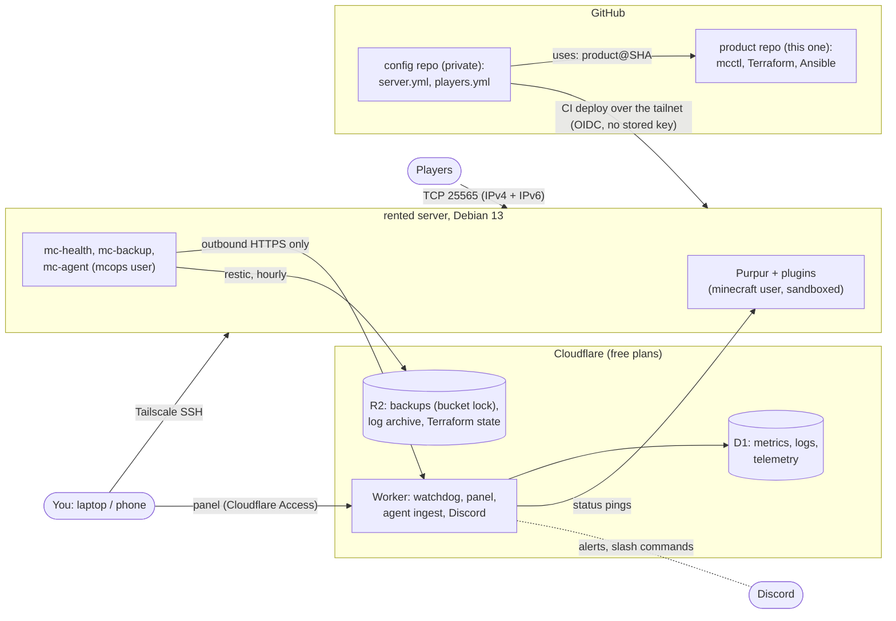

# Smallworld

A self-hosted, always-on Minecraft (Purpur) server for friends, run as code. You describe the server in one
`server.yml`, and `mcctl setup` creates everything else: DNS, backups, monitoring, an admin panel, a hardened
Debian host and a CI pipeline that deploys every `git push`. After setup it mostly runs itself. Build updates
are tested and merged every week, reboots wait until nobody is playing, a watchdog outside the box notices when
it is down, and the world is backed up every hour to storage the server itself can't wipe.

Version **1.3.0** ([CHANGELOG](CHANGELOG.md)). Built for one admin with a handful of players. A tour with
screenshots: [docs/features.md](docs/features.md). Built and maintained by Edvard Kristiansen
([GitHub](https://github.com/edvardk)).

| You get | How |
|---|---|
| A server people can join on IPv4 and IPv6 | Purpur on a rented server (e.g. a netcup root server), plugins pinned by hash, configs managed by value |
| Changes by pull request | Edit `server.yml` or `players.yml` in your private config repo, push; CI deploys within minutes, with an in-game countdown when a restart is needed |
| Hourly backups you can't lose by accident | restic to Cloudflare R2 with a bucket lock (7 days), restore checks every week |
| Monitoring and self-heal | `mc-health` on the box restarts a crashed or frozen server; a Cloudflare Worker outside the box probes IPv4 and IPv6 and alerts on Discord |
| An admin panel | `https://panel.<your domain>` behind Cloudflare Access: live stats, console, players, whitelist, backups, restore, logs, player experience |
| Discord commands (optional) | `/status`, `/players`, `/lag`, `/backup now`, `/whitelist add`, ... |
| A locked-down host | no public SSH (Tailscale SSH only), nftables with per-source limits, systemd sandboxes, privilege-separated helpers ([SECURITY.md](SECURITY.md)) |

## How it fits together



Two repositories: **this one is the product** (code only, no deployment values), and each server has its own
private **config repo** created by `mcctl setup` from [`template/`](template/). The config repo pins the product
by commit SHA, so nothing changes on your server until that pin moves (weekly product patch releases move it by
themselves; `mcctl upgrade` for the rest). Terraform state is the only secret store; nothing secret is in git.
More: [docs/reference.md](docs/reference.md#architecture).

## What it costs

| Item | Cost | Notes |
|---|---|---|
| A server with dedicated CPU cores and 8 GB RAM (e.g. a netcup root server) | your provider's monthly price | Recommended. A cheaper VPS with shared vCores works for a small group but suffers CPU steal at busy times ([setup, step 13](docs/setup.md#step-13-the-server-machine)) |
| A domain | a registrar's yearly price | Any registrar; its DNS must move to Cloudflare |
| Cloudflare | free | Free plans: DNS, Workers, D1, R2 (10 GB), Zero Trust Access (up to 50 users). The telemetry is sized to stay well inside the free daily limits ([operations](docs/operations.md#what-telemetry-costs)) |
| Tailscale | free | Personal plan |
| GitHub | free, or **Pro** | Rulesets on a private repository of a personal account need a paid plan. Without one, set `github.protect_main: false`: everything works, but the panel's GitHub App could then push to `main` ([SECURITY.md](SECURITY.md#not-covered-v1)) |
| Discord, Dashlane | free / optional | Discord apps are free; Dashlane is only an optional place for the admin tokens |

Nothing else is billed. mcctl never orders or pays for anything: you buy the server and the domain yourself.

**Sizing.** The product default is the vanilla performance profile (every game mechanic as in vanilla; only
invisible optimisations, ZGC): simulation distance 8, view distance 10, no entity activation ranges. That is what
4 dedicated cores and 8 GB are sized for with 5-6 players and decent mob farms; the `balanced`
profile is cheaper if a smaller box has to do ([operations](docs/operations.md#performance-profile)).

## Quick start

You need a Linux, macOS or Windows (WSL2) machine with Python >= 3.12, git, the GitHub CLI, Terraform 1.17.1,
Tailscale and an SSH key; [docs/setup.md](docs/setup.md#1-prepare-your-computer) has the per-OS steps.

The product repository `edvardk/smallworld` is public; clone it (or your fork) with `gh` after
`gh auth login`. (It started out private; a private copy still works, with the optional `PRODUCT_READ_TOKEN`
described in [docs/reference.md](docs/reference.md#github-settings).)

```bash
mkdir -p ~/code && cd ~/code
gh repo clone edvardk/smallworld && cd smallworld
python3 -m venv .venv && . .venv/bin/activate
pip install --require-hashes --no-deps -r requirements/deploy.txt
pip install --no-deps -e .           # the `mcctl` command in this venv (else: python3 -m mcctl)
ansible-galaxy collection install -r ansible/requirements.yml
mcctl setup -C ~/code/mc-config
mcctl                                  # afterwards: the home screen (status + menu; remembers the config repo)
```

`mcctl setup` is a resumable checklist of 17 steps: stop at any point, run the same command again and it
continues where it left off. It tells you exactly what to click where it can't do something itself (creating the
Cloudflare token, ordering the server), checks every credential live, and asks you to type a confirmation before
anything that changes your cloud accounts. Plan on about two hours for a first run, most of it waiting for the
server order. [docs/setup.md](docs/setup.md) walks through every step and lists every error we have hit, with
its fix.

After setup: [docs/operations.md](docs/operations.md) (the panel, Discord, `mcctl` commands, what runs by
itself, backups and restores).

## Documentation

| Page | For |
|---|---|
| [docs/features.md](docs/features.md) | What Smallworld gives you, feature by feature, with screenshots |
| [docs/setup.md](docs/setup.md) | First setup end to end: accounts, tokens, ordering the server, what bootstrap changes, troubleshooting |
| [docs/operations.md](docs/operations.md) | Day 2: panel tour, Discord commands, `mcctl` commands, weekly automation, backups and restore drills, the Experience tab, monitoring |
| [docs/new-world.md](docs/new-world.md) | The first start of a brand-new world |
| [docs/player-guide.md](docs/player-guide.md) | For players: commands, the optional client (`/modpack`), seeing further (`/view`) |
| [docs/reference.md](docs/reference.md) | Architecture, design notes, secrets inventory, the full command list, Terraform by hand, version bumps, moving to a new machine, GitHub settings, releasing |
| [SECURITY.md](SECURITY.md) | Threat model, privilege separation, hardening, what is deliberately not covered |
| [CHANGELOG.md](CHANGELOG.md) | What changed in each release |
| [CONTRIBUTING.md](CONTRIBUTING.md) | Working on the product: lint and test commands, conventions |
| [docs/ci.md](docs/ci.md) | The product's CI: what runs when, required checks, expected Actions minutes, an optional self-hosted e2e runner |
| [docs/map.md](docs/map.md) | Where each feature lives (code, tests, docs) and the phase glossary |
| [`CLAUDE.md`](CLAUDE.md) | The rules for agents working in this repo |

## Status

v1.0.0: all product phases (P1-P15) are built and tested in CI, including a mock end-to-end setup and a real
Purpur server in a systemd Debian 13 container with the hardening checked live. A live setup (November 2026)
confirmed the Cloudflare, Zero Trust and GitHub App flows. After v1: performance
knobs for tail latency (P16: ZGC, CPU split, chunk threads, noatime; see
[operations](docs/operations.md#performance-tuning)), the vanilla performance profile (ZGC by default,
[operations](docs/operations.md#performance-profile)); branding (P17: server name, colours, MOTD, icon, greetings,
rules, an optional sidebar and signature drink; [operations](docs/operations.md#branding)). v1.1: an optional client
modpack in four tiers with a code-gated setup page, a pinned artifact mirror, and `/view` up to 16
([operations](docs/operations.md#the-client-modpack-and-view)); optional later: an on-server
panel mode and a Grafana add-on (P18).

License: MIT ([LICENSE](LICENSE)). Bundled third-party files keep their own licences (e.g. the fonts:
`watchdog/panel/fonts/OFL.txt`).
