# What Smallworld gives you

A tour for newcomers: what a Smallworld server does for its admin and its players, one feature at a time.
Every screenshot comes from a mock or test run against made-up fixture data (a server called "Lighthouse",
players such as `MiaBuilds` and `jonas_r`); nothing here is a real deployment. `python scripts/screenshots.py`
regenerates them. Features that only exist inside the game (holograms, the map, graves) have no screenshot.

To set a server up, start with [setup.md](setup.md); day-to-day use is in [operations.md](operations.md).

## The admin panel

`https://panel.<your domain>`, behind Cloudflare Access: live tick rate, tick time, players, CPU, memory, disk
and network at a glance, with warnings on top. The header's buttons restart, stop or back up the server; every
action is signed and written to the audit log. It works on a phone as well as on a desktop.
More: [operations: The panel](operations.md#the-panel).

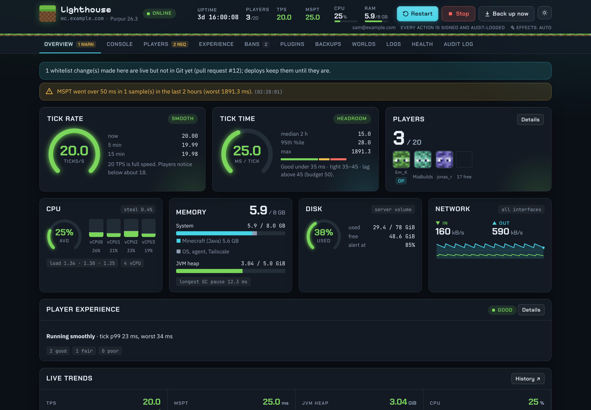

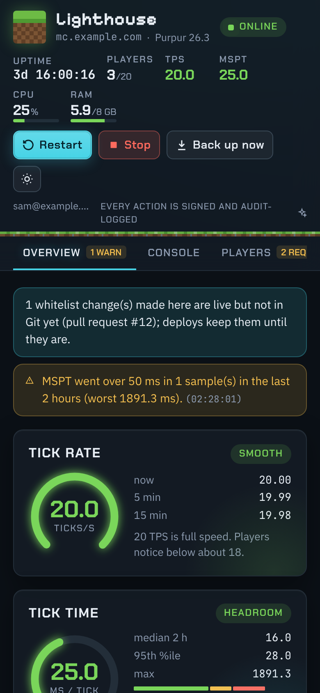

**Console**: a live server console with filters, history and tab completion. Commands go through an allowlist;
`stop`, `op` and friends are refused (the buttons warn players first).

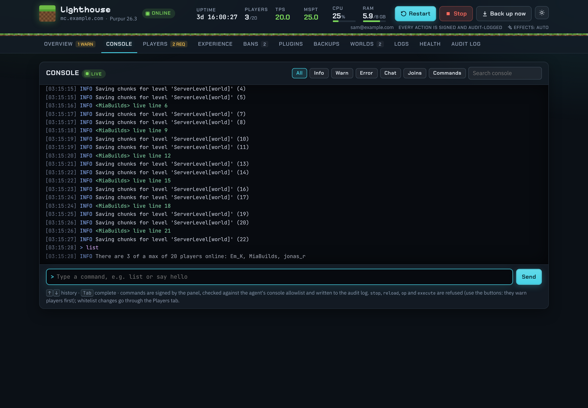

**Players, bans, plugins, backups, logs, health, audit log**: whitelist a player (checked against Mojang, then
written to Git by a pull request that merges by itself), approve a rejected login, kick or ban, switch a
plugin, restore a backup, search the server's journal, and see the watchdog's view from outside.

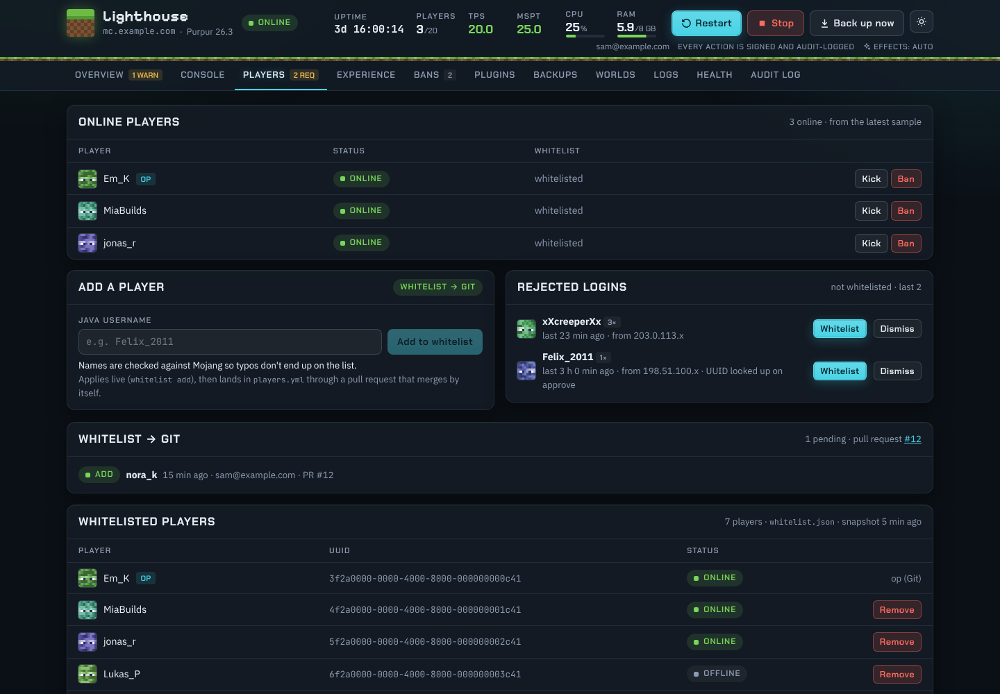

**Versions and the Panel → Git self-test** (v1.3): the header names the Smallworld version and the server
build ("Smallworld v1.3.0 · Purpur 26.3"); the Health tab compares what the server runs, what the Worker runs and
the config repo's pin, and says how to fix a mismatch ("run `mcctl render` + `mcctl apply`", "deploy"). A daily
self-test proves the panel can still open pull requests on the config repo, without opening one, and says which
step failed (Discord after two failures); run it from the Health tab any time. Whitelist names are checked with
Mojang from the server itself, so Mojang's refusals of Cloudflare's addresses no longer get in the way.

Destructive actions (restore, world switch, plugin changes) are confirmed in a separate window, signed in again
with a one-time PIN, by typing a phrase. [SECURITY: Panel actions](../SECURITY.md#panel-actions-p10-what-the-panel-can-change).

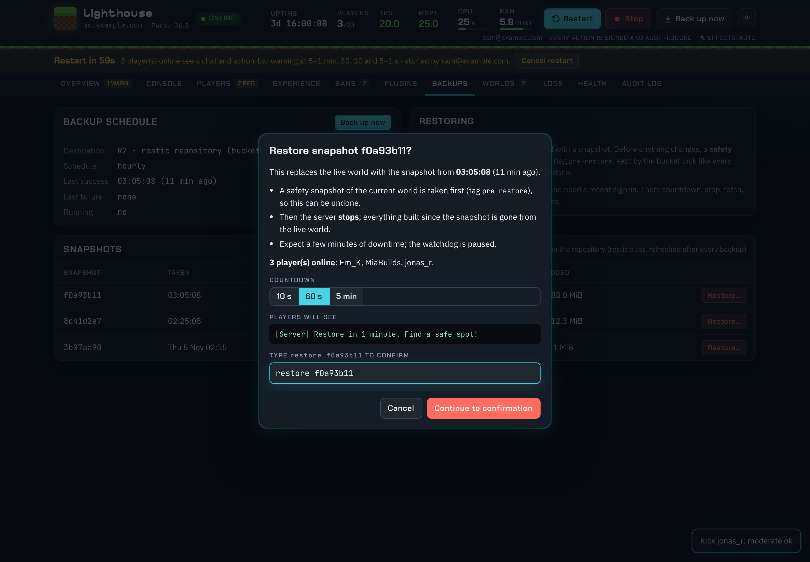

## Worlds and the seed catalogue

The Worlds tab keeps a library of worlds: only the active one is on the server, the others are archived in
R2. Create a new world from a seed, a world type and a server preset (survival, creative build, hardcore, ...),
switch to an archived one or delete it. A switch warns the players with a countdown and archives the active
world first. More: [operations: World library](operations.md#world-library), [new-world.md](new-world.md).

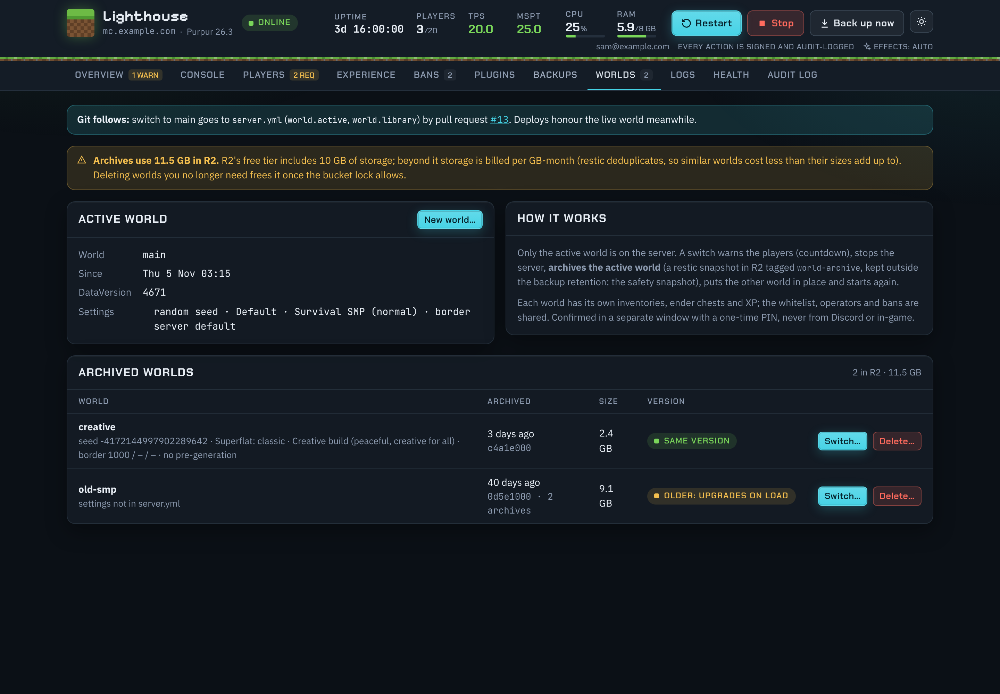

"Start from" offers researched seeds, each checked on the pinned Minecraft version with `/locate`: the panel
shows what is near spawn and how far, as measured.

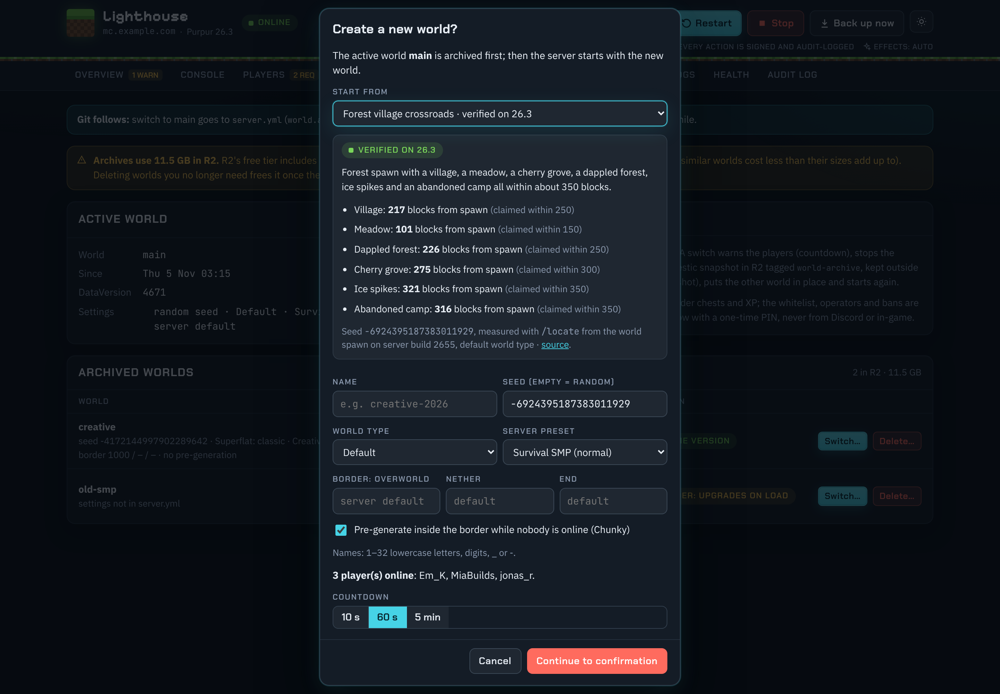

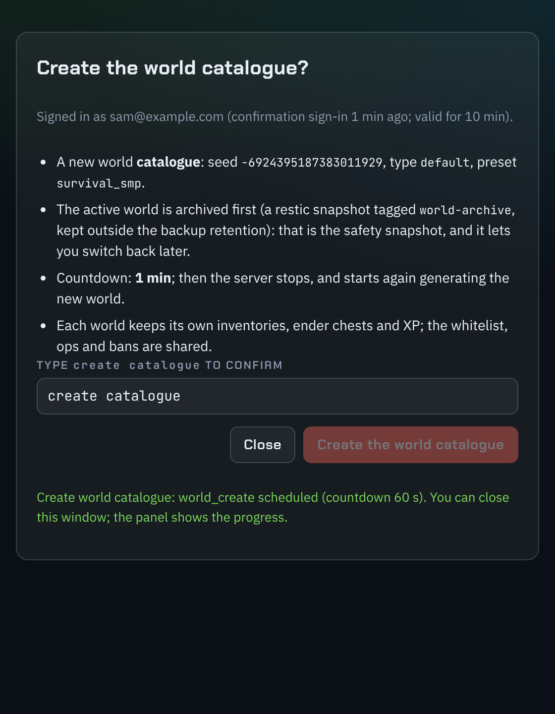

## The Experience tab

Per player, a plain verdict (good, fair, poor) and why: the server, the connection or the player's own
computer, with what would help. History charts carry deploy and maintenance markers; in game, `/lag` says the
same. More: [operations: The Experience tab](operations.md#the-experience-tab).

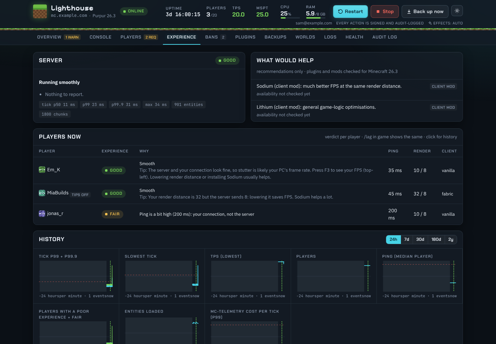

## The client setup page

An optional modpack (Sodium and friends, a minimap and world map, chat heads) in tiers for slow to fast
computers, installed with the official Minecraft Launcher in four steps. Players get their link with
`/modpack` in game; the page shows only their operating system's steps, dark by default.
More: [operations: The client modpack and /view](operations.md#the-client-modpack-and-view),
[player-guide.md](player-guide.md#the-optional-client-smoother-further).

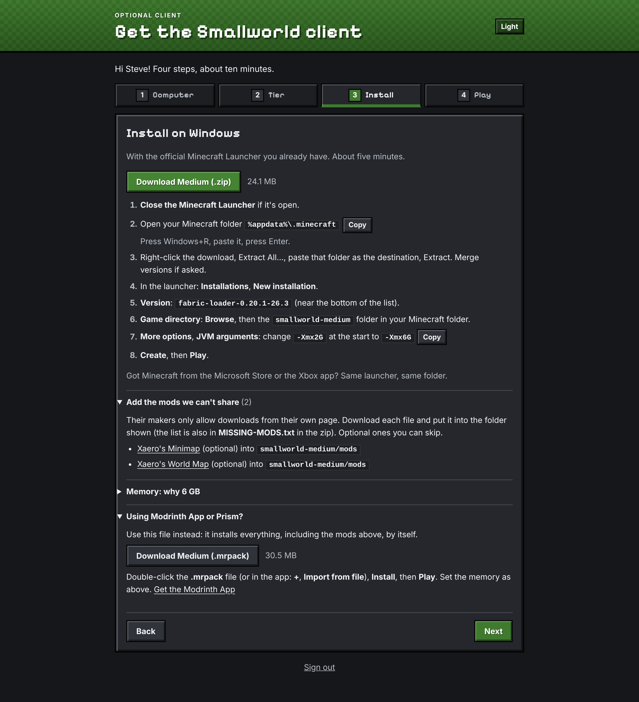

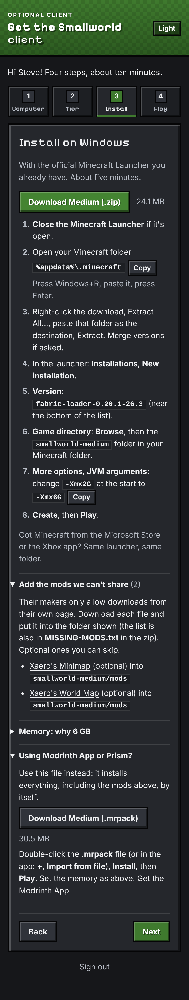

## Alerts and self-heal

On the box, `mc-health` restarts a crashed or frozen server; outside it, a Cloudflare Worker probes IPv4 and
IPv6. Alerts go to Discord when the server is down, lagging, short of memory or disk, or a backup fails; each
says what it means for players, the likely cause and what to do, and a recurring one reminds at most every few
hours. Warnings also show at the top of the panel (above: "MSPT went over 50 ms"). Reboots for updates wait
until nobody is playing.
More: [operations: Alerts](operations.md#alerts), [Monitoring](operations.md#monitoring).

## Branding and the drink

Your server's name, MOTD, join texts, a server-list icon and, if you like, a signature drink: every player gets
one, it can be drunk forever (a harmless Nausea), and `/drink` replaces a lost one. A small resource pack gives
it its texture and chat texts an icon. The product's neutral art is below; a config repo brings its own.
More: [operations: Branding](operations.md#branding).

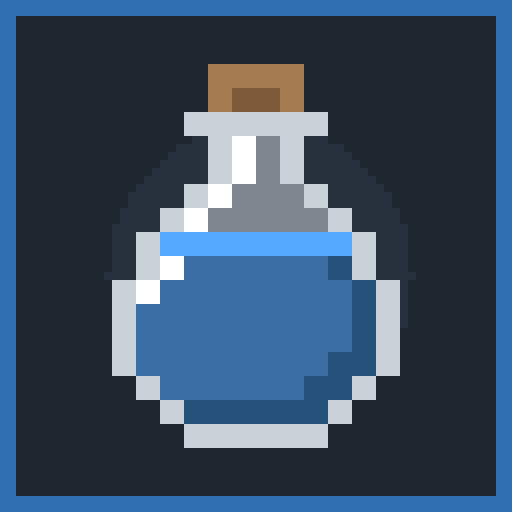


## Holograms at spawn

Up to ten floating texts, e.g. "Welcome to Lighthouse" and "3 online", that any vanilla client sees, with an
optional live health line (`branding.holograms` in `server.yml`). They are never saved with the world.
More: [operations: Branding](operations.md#branding).

## The map, with friends on it

With the client pack, Xaero's minimap and world map work with fair-play settings (no cave map, no entity radar)
and show your friends at any distance in the same dimension. Without mods, the vanilla Locator Bar is on, and
half the players asleep skip the night. More: [player-guide.md](player-guide.md).

## Finding friends without mods: the compass, /map and /help

Every vanilla client gets a **friend compass** (v1.3), a bar at the top of the screen that turns with the player:

```
   W   ·    ·   NW   ·  ▼Alex 120m↑  ·   NE   ·     Sam | Kim (Nether)
```

Cardinal points and every online player's name at their bearing; the player faced is in the middle with the
distance (rounded) and an arrow when they are well above or below; players in other dimensions come after the
bar, without a distance. `/compass on|off` (per player, remembered), `/compass hide` (stay off everyone else's
compass and map), `/compass auto` (back to the default below).

**`/map`** gives a personal **pocket map**: it re-centres on the player about once a second while held (in the off
hand it's a minimap), shows every other player as a named arrow (a dot at the edge beyond the map) and fills in
the terrain as the player explores, like any vanilla map. `/map zoom` cycles the scale. One per player, free to
re-get, and it can't be copied, framed, stored or dropped (a dropped one just disappears).
v1.4: terrain the player hasn't visited comes from the nightly world map render, so a fresh map shows the land at
once (Overworld and End; vanilla's own colours take over as the player walks). The optional **spawn map room**
(`branding.map_room`) hangs a wall of maps of the whole world near spawn, refreshed every night.

**`/help`** (also `/commands`) lists the commands this player can use, built from what's switched on, each one a
click away; Minecraft's own list stays at `/minecraft:help`. A hologram with `help: true` shows the same list,
for example above the world spawn (`at: spawn`).

**The better client mods come first.** mc-brand looks at the plugin channels each client registers (and checks
again when one registers late):

| Client | Compass | `/map` |
|---|---|---|
| Smallworld client mod + Xaero's maps (the client pack) | off: friends are on Xaero's minimap | works, not suggested |
| Xaero's maps, no Smallworld mod | on | works (friend arrows on top of Xaero's) |
| No mods | on | works, and a one-line tip at join suggests it |

`/compass on|off` and `/map` always override this; the vanilla Locator Bar stays on for everyone. Settings:
`branding.compass` (on by default, `max_range`, `distance_rounding`, `height_threshold`, `default_on`) and
`branding.pocket_map.enabled`. More: [operations: Branding](operations.md#branding).

## Graves

When a player dies, their items and XP wait in a grave where they fell, for 15 minutes, and only they can open
it; after that the items drop as in vanilla.

## Backups you can't lose by accident

The world is backed up every hour with restic to Cloudflare R2 behind a bucket lock, and a restore is tested
every week on the server itself. Restore from the panel or with `mcctl restore`.
More: [operations: Backups and restore drills](operations.md#backups-and-restore-drills).

## Run as code

Everything is described in one `server.yml` in your private config repo; a `git push` deploys, with an in-game
countdown when a restart is needed. `mcctl setup` creates the accounts' resources step by step (shown here
against the mock providers). More: [setup.md](setup.md), [reference.md](reference.md).

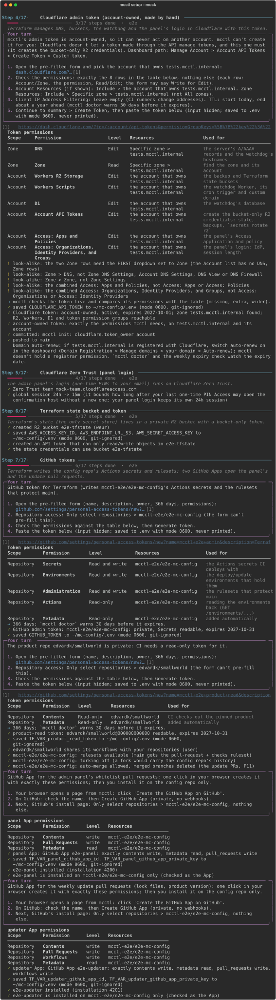
