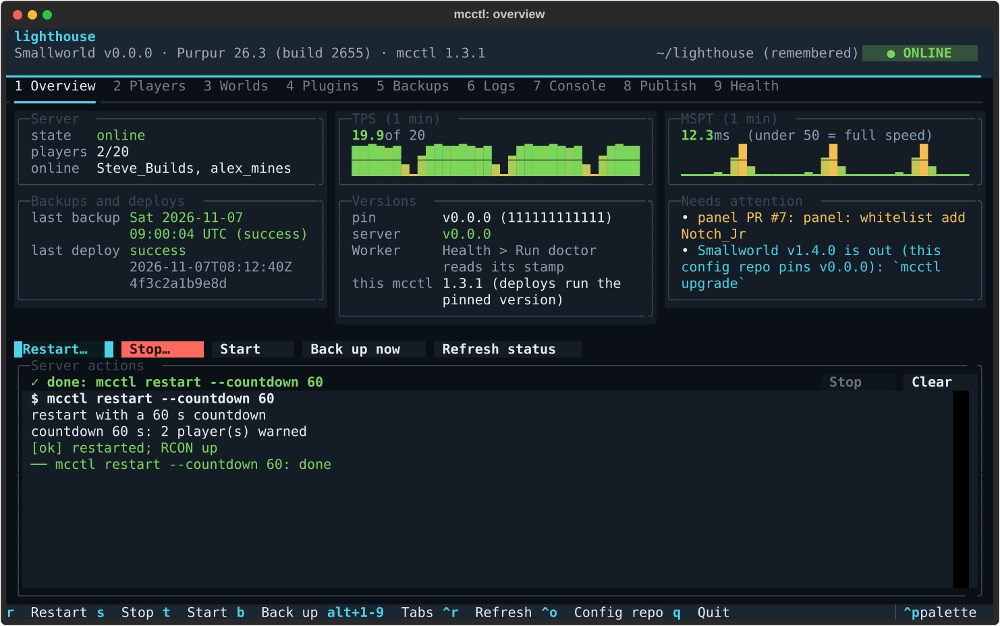

# Reference

The details behind [setup](setup.md) and [operations](operations.md): how the pieces fit, where every secret
lives, the full `mcctl` command list, running Terraform by hand, version bumps, moving to a new machine, the
product/config-repo split, GitHub settings and releasing. New here? Start with the [README](../README.md).

## Contents

- [Architecture](#architecture) ([design notes](#design-notes), [access model](#access-model))
- [Secrets inventory](#secrets-inventory) ([running Terraform](#running-terraform), [Tailscale OAuth client](#tailscale-oauth-client-for-terraform))
- [Setup by hand](#setup-by-hand)
- [mcctl commands](#mcctl-commands)
- [World map](#world-map) (v1.4: the tile format and how mc-brand reads it)
- [Bumping versions](#bumping-versions)
- [Move to a new VPS](#move-to-a-new-vps)
- [Product and config repos](#product-and-config-repos) ([automation](#automation-p11), [GitHub settings](#github-settings), [releasing](#releasing))
- [Example deployment](#example-deployment) ([decisions](#decisions), [host](#host))
- [Development](#development)

## Architecture

```
            players ──TCP 25565──▶ ┌──────────────────────────────┐
                (IPv4 + IPv6)      │ rented server (Debian 13)    │
  admin laptop/phone ─┐            │  Purpur + plugins (systemd)  │
                      ├─tailnet──▶ │  Tailscale SSH (no pub. 22)  │
  GitHub Actions ─────┘            │  restic hourly ────────────────▶ Cloudflare R2 (bucket lock)
     (Ansible deploy, OIDC)        └──────────────────────────────┘
  Terraform ──▶ Cloudflare (DNS, R2) · Tailscale (ACLs, keys, CI identity) · GitHub (config repo secrets)
```

| Path | What |
|---|---|
| `terraform/` | A + AAAA records, R2 bucket + bucket lock + scoped token, Tailscale ACL / server key / CI federated identity, Actions secrets, generated passwords, the watchdog Worker (script, cron, D1, custom domain, workers.dev off; P8: Control Durable Object, R2 log bucket + lifecycle, agent token and command key) |
| `watchdog/` | The Cloudflare Worker (`worker.js`, no dependencies, no build): watchdog, agent ingest, the Control Durable Object; its `node --test` unit tests |
| `ansible/bootstrap.yml` | One-off over public SSH: Tailscale → deploy user/sshd hardening → firewall |
| `ansible/site.yml` | Everything else; run by CI over the tailnet. Roles: access, base, hardening, firewall, tailscale, java, backups, plugins, minecraft, monitoring |
| `ansible/library/mc_config.py` | Merges our settings into server configs by **value** (see below) |
| `server-config/*.j2` | Config overlays: only the keys we manage. `keys/<version>/` lists every valid key |
| `template/` | The config-repo skeleton (`server.yml`, `players.yml`, lock files, `expiry.yml`, `.env.example`, the single pinned workflow). Its lock files are the product's reference pins |
| `examples/config-repo/` | The template materialized with fake example.com values: CI fixture only (`scripts/sync_example.py`) |
| `examples/full/server.yml` | A deployment with every feature on: the tests' reference `server.yml` |
| `scripts/` | Python. On the server (stdlib only): `mc_rcon`, `backup`, `restore`, `health` (+ self-heal, Chunky pre-generation), `notify` (watchdog heartbeats, maintenance windows and the other markers, Discord), `admin`, `mc_agent` (metrics, logs and signed commands to the Worker). Controller: lock/key tooling, smoke test |
| `rust/` | Rust (v1.4). `smallworld-rcon`: the drop-in for `mc_rcon.py`'s command line, called by `ExecStop`, the deploy's countdown, world borders and game rules, and `mc`. Pinned toolchain, std only, static musl binaries for x86_64/aarch64 committed in `rust/dist/` (rebuilt byte for byte by `scripts/build_rust.py check`); walkthrough: [rust/smallworld-rcon.md](rust/smallworld-rcon.md). `smallworld-map`: the nightly world map pre-renderer (std only; [rust/smallworld-map.md](rust/smallworld-map.md)). `smallworld-agent`: the port of mc-agent, behind `agent.implementation` (below; [rust/smallworld-agent.md](rust/smallworld-agent.md)) |
| `mcctl/`, `schema/` | Product v1 CLI (P1–P6 so far): `server.yml` schema + validation, config-repo loading, `render`, `deploy`, `doctor` (token validators, `expiry.yml`), `status`, `plan`/`apply`, `bootstrap`, tailnet wrappers, state file, pinned-product cache; generated JSON Schema |
| `.github/workflows/` | `server` (**reusable**: what every config repo runs: validate + gitleaks, deploy, backup-check), `ci` (lint, tests, gitleaks over the history, actionlint, the example config repo through `server`), `e2e-mock` (`mcctl init --mock` → validate → `terraform validate` → site.yml in a systemd Debian 13 container with the real Purpur, idempotent second run, then the P7 hardening checked live: `systemd-analyze security` gate, sysctls, sshd masked, admin-stopped, the firewall ruleset's limits in a network namespace), `release` (tags + source archive and `SHA256SUMS`), `update-lock` (manual, reference locks). `dependabot.yml`: weekly Actions + pip bumps |

### Design notes

- **Config overlays, not full templates.** Paper/Purpur rewrite their YAML on every start (comments,
  ordering, new defaults), so full-file templates would differ on every run and restart the server on every
  deploy. `mc_config` compares parsed values and writes only when a managed key differs. Overlays are applied
  while the server is **stopped** (in the restart handler), so it can't overwrite them on shutdown.
- **Restarts only on real change** (jar, plugin, JRE, unit or overlay): 60/30/10 s in-game countdown (skipped
  when nobody is online), Discord notice, then `ExecStop` does `save-all flush` + `stop` over RCON. v1.4: these run
  `smallworld-rcon` (Rust, `rust/`), identical to `mc_rcon.py`'s command line; `ExecStop` falls back to
  `mc_rcon.py stop` only if the binary gives no answer at all ([the stop path](rust/smallworld-rcon.md#the-stop-path)).
- **Two agent implementations (v1.4).** `server.yml` `agent.implementation` picks what runs as mc-agent:
  `rust` (the default since v1.4.0; `smallworld-agent`, the complete port, proved against the Python agent by
  the parity harnesses) or `python` (the supported fallback; `scripts/mc_agent.py`, the experience telemetry in
  the same process). Every box gets the pinned binary (`/opt/minecraft/bin/smallworld-agent`,
  root 0755) and `/opt/minecraft/bin/mc-agent`, a symlink to the chosen implementation that mcctl's actions run
  (`mc-agent cli`; `mc_agent.py cli` on a box older than v1.4). `mc-agent.service` runs the chosen one directly,
  in the same sandbox, as the same user. Both run the experience telemetry in-process (the Rust agent: its
  `telemetry` module, the port of `scripts/telemetry.py`, proved by its own parity harness): the same snapshots in,
  minute rows, segments and verdicts out, `player_message` reading who is online from it, no unit of its own. Both
  implementations share every state file (`telemetry-id.json` and the segments included), so a switch either way
  is a deploy; a new binary, a switch or a new product version restarts the agent. `product-version.json` records
  `agent: {implementation, sha256}`. Operations: [operations.md](operations.md#switching-the-agents-implementation-v14).
- **Verified keys.** `scripts/config_keys.py` rebuilds the pinned Purpur jar from the vanilla jar and Purpur's
  patch (hash-checked), then lists every config key via `javap`. No server code is run. `pytest` fails if an
  overlay uses a key that doesn't exist in the pinned version. spark is bundled with Paper, so it isn't a plugin.
  DAB isn't in this Purpur version, so it isn't set.
- **Secrets never on a command line.** Ansible's `environment:` with `become` puts variables into the
  `sudo ... sh -c 'VAR=...'` string (visible in `ps` and the journal). Tasks that need secrets run through
  `mc-run ENV_FILE CMD` (a transient `systemd-run` unit as the ops user `mcops` that reads the root-only env
  file itself); `mc-restic` is `mc-run /etc/minecraft/restic.env`.
- **Two users.** The JVM and its plugins run as `minecraft`; everything that holds a credential (backup, prune,
  health, notify, the fetch half of a restore, `mc-run`) runs as `mcops`, which is in group `minecraft` (read-only
  access to the server dir and its RCON password) but not the other way round. Code in the JVM can't read the
  helpers' env files or `/proc/<pid>/environ`, nor forge the self-heal markers in `/var/lib/minecraft`
  ([SECURITY.md](../SECURITY.md#privilege-separation)).
- **Heap = total RAM − 2 GB, rounded down to 256 MB** (5632 MB on the 8 GB VPS). PLAN said −1.2 GB, but with
  `AlwaysPreTouch` the heap is resident from the start, and metaspace, code cache, Netty direct buffers, GC
  structures and thread stacks come on top, plus the OS, tailscaled and restic during backups. A 1.2 GB reserve
  risks the OOM killer picking java; the backup units also set `OOMScoreAdjust=500` so restic goes first.
- **No stacker plugin.** RoseStacker (the original plan) has no 26.3 release, and the only 26.3-tagged
  alternatives were closed-source or barely used. Farm lag is handled by vanilla/Paper/Purpur settings
  instead: tighter mob caps (`bukkit.yml` spawn-limits), per-player mob spawns, entity activation ranges
  and item/XP merge radius (`spigot.yml`), villager lobotomy and smaller villager search radii (`purpur.yml`),
  and collision limits (`max-entity-collisions`). If spark shows farms are still the problem, re-add a
  stacker once one supports the pinned version.
- **Tailscale SSH**, not OpenSSH over the tailnet: no long-lived SSH key in GitHub or Terraform state. Who can
  log in as whom is in `terraform/tailscale.tf`. CI nodes are ephemeral. Break-glass: the provider's console (e.g. netcup's SCP).
- **No Tailscale secret in GitHub.** The deploy job of the reusable workflow joins the tailnet through **workload identity federation**:
  it requests a GitHub OIDC token (`permissions: id-token: write`) and `tailscale/github-action` exchanges
  it with `tailscale_federated_identity.ci`, which trusts only the config repo's main branch
  (`sub` = `repo:<owner>/<config repo>:ref:refs/heads/main`; in a reusable workflow the standard claims describe
  the caller) **and** only the product's reusable workflow (`custom_claim_rules`:
  `job_workflow_ref` = `<product repo>/.github/workflows/server.yml@*`). Issuer
  `https://token.actions.githubusercontent.com`, scope `auth_keys`, tag `tag:ci`. The client ID and the
  Tailscale-generated audience are Actions secrets `TS_OAUTH_CLIENT_ID` / `TS_AUDIENCE` of the config repo,
  useless outside such a run.
- **Tailscale is held at a pinned version** (`tailscale_version`, apt hold), so Tailscale security fixes
  don't arrive with unattended upgrades: watch the [Tailscale security bulletins](https://tailscale.com/security-bulletins)
  and bump the pin by hand (Bumping versions).
- **Hourly backups.** `backup.py` pauses saving (`save-off`, then `save-all` and a wait for the world's files to
  go quiet, `save-all flush` only as the fallback: v1.5), snapshots, then `save-on` in a `finally`. v1.5: a run
  the timer started (`TRIGGER_UNIT=mc-backup.timer`, set by systemd) is skipped when nobody played and no file
  changed since the last backup (a fingerprint in `/var/lib/mc-snapshots/backup-state.json`; at least one real
  backup a day) and deferred up to `backups.max_defer_minutes` while players see lag
  ([operations: Smooth backups](operations.md#smooth-backups-v15)). `mc-backup.timer` runs hourly (+ up to 5 min random delay, catches up after downtime); the
  weekly prune runs Sundays at 03:30, between backups, and restic waits for each other's locks
  (`--retry-lock 30m`) instead of failing.
- **No silent new world.** On a box without a world, `restore.py --if-missing` restores the newest
  snapshot before the first start. If there is no snapshot it prints `NO_SNAPSHOT`; with
  `mc_world_expected: true` (set once the world is backed up) the deploy then **fails** instead of letting
  the server generate a new world (e.g. wrong R2 credentials or bucket in the Terraform outputs). After every live
  restore, `<server dir>/.restored-from` records the source (one line of JSON, not backed up).
- **R2 bucket lock.** Objects matching a lock rule can't be deleted or overwritten until the rule releases
  them, and the server's R2 token (object read/write on one bucket) can't change the rules. restic deletes
  objects in normal operation, so the rules follow its repository layout:

  | Prefix | restic deletes it when | Lock |
  |---|---|---|
  | `config`, `keys/` | never (only `restic key remove`) | **Indefinite**: the repository can't be bricked |
  | `snapshots/` | `forget` | **7 days** (`r2_lock_days`). `backup.py` adds `--keep-within 8d`, so `forget` only touches snapshots older than the lock (1 day clock-skew margin; `pytest` checks the two agree) |
  | `data/` | `prune` (unused or repacked packs) | **7 days**. restic's prune ignores pack deletions that fail ("keeping too many packs cannot damage the repository", verified in the 0.19.1 source), drops them from the index, and deletes them on a later prune once the lock has expired. `restic check` reports them only as non-critical "additional files" |
  | `index/`, `locks/` | every prune / every command | **None**: prune treats a failed index deletion as fatal, and lock files must go. The index can be rebuilt from the packs (`restic repair index`) |

  What it buys: a compromised server (or a bad script) can't destroy the repository keys, any snapshot
  younger than 7 days, or any pack uploaded in the last 7 days. **Caveat:** a recent snapshot also
  references older, deduplicated packs, and those are only protected for 7 days after upload, so a
  determined attacker with the server's credentials could still damage recent snapshots by deleting old
  packs. Full protection would need an indefinite lock on `data/` (no space is ever reclaimed until the admin
  lifts the rule with his admin token) or a second, independent copy. Lifting or changing a rule needs
  the admin's Cloudflare token (`terraform apply`), never the server's.

### Access model

| Who | Reaches | How |
|---|---|---|
| Players | `mc.<zone>:25565` (IPv4 and IPv6) | Public internet (DNS-only records, grey cloud) |
| The admin | everything on the tailnet; SSH as `deploy` | Tailscale |
| GitHub Actions | `tag:mc-server` TCP 22 only, as `deploy` | Ephemeral `tag:ci` node via OIDC |
| RCON | `127.0.0.1:25575` only | `mc <command>` on the box |

Public firewall (nftables, host is the source of truth): TCP 25565 and UDP 41641 (Tailscale WireGuard,
silent to scans) are open, plus ICMP/ICMPv6. Everything else, including 22, is dropped. New 25565 connections
are limited per source (IPv4 address, IPv6 /64): 20 a minute after a burst of 30, at most 10 at once
(`firewall.max_connections_per_source` in `server.yml`); drops are logged (`journalctl -k | grep mc-`, at most
10 lines a minute). **Shared addresses:** everyone behind one IPv4 address (carrier-grade NAT on mobile and some
home ISPs, a LAN party, a school or office) or in one IPv6 /64 counts as **one** source: 11 friends on one
address can't all be connected at once, and many reconnects in a minute (a crash, a server restart) can trip the
rate limit for a few seconds. Raise `firewall.max_connections_per_source` for such groups. If an attacker fills
the per-source tables (65535 sources, e.g. an IPv6 /48), new sources are dropped until entries expire
(`mc-setfull:` in the kernel log) rather than let through unlimited; players already connected or seen in the
last 10 minutes keep working. OpenSSH itself is masked after bootstrap: the
only way in is Tailscale SSH (break-glass: the provider console, [SECURITY.md](../SECURITY.md#hardening-on-the-box-design-7-as-built-in-p7)).
Every service runs in a systemd sandbox (`systemd-analyze security <unit>`: ≤ 2.5, minecraft ≤ 4.5), the
kernel/network sysctls of the `hardening` role apply, and the journal is persistent (1 GB cap).

## Secrets inventory

| Secret | Lives in | Created by |
|---|---|---|
| `CLOUDFLARE_API_TOKEN`, `GITHUB_TOKEN`, TF-state `AWS_*` | config repo `.env` | the admin |
| `TAILSCALE_OAUTH_CLIENT_ID` / `_SECRET` (Terraform's Tailscale OAuth client, doesn't expire) | config repo `.env` | the admin ([below](#tailscale-oauth-client-for-terraform)) |
| Discord webhook (optional) | config repo `.env` (`TF_VAR_discord_webhook_url`) → TF state → Actions secret + watchdog Worker secret | the admin |
| Discord bot token (optional, P14 slash commands) | config repo `.env` (`DISCORD_BOT_TOKEN`) only: mcctl registers the commands and sets the endpoint with it | the admin (developer portal) |
| `PRODUCT_READ_TOKEN` (optional, only for a private product repo: Contents read on the product) | `.env` (`TF_VAR_product_read_token`) → TF state → Actions secret | the admin |
| R2 backup credentials (bucket-scoped object read/write) | TF state → Actions secrets | Terraform |
| RCON password, restic password | TF state → Actions secrets | Terraform (`random_password`) |
| Watchdog heartbeat token | TF state → Actions secret + Worker `secret_text` binding | Terraform (`random_password`) |
| Agent token, command HMAC key (P8: mc-agent ↔ Worker) | TF state → Actions secrets + Worker `secret_text` bindings; on the box only in root-only `agent.env` | Terraform (`random_password`) |
| Artifact publish token (v1.1: the deploy job's uploads to the artifact mirror, `mcctl client-publish`) | TF state → Actions secret `ARTIFACT_PUBLISH_TOKEN` (environment `deploy`) + Worker `PUBLISH_TOKEN`; never on the server | Terraform (`random_password`) |
| Client key (v1.1: signs the setup page's sessions and links, keys the one-time codes' hashes) | TF state → Worker `CLIENT_KEY` only | Terraform (`random_password`) |
| Tailscale server auth key (single use, 24 h) | TF output, minted with `-replace` right before bootstrap | Terraform |
| CI tailnet access | Nothing secret: federated identity (`TS_OAUTH_CLIENT_ID`, `TS_AUDIENCE` Actions secrets) | Terraform |

**Terraform state is the only secret store; nothing secret is in git.** The deploy secrets are listed once
in [`mcctl/secrets.py`](../mcctl/secrets.py). Each `NAME` is a Terraform output (`name`), an Actions secret
(`NAME`; the optional Discord one only exists when set) and, for Ansible, an environment
variable `MC_SECRET_NAME` that `ansible/group_vars/all/secrets.yml` reads. The config repo's workflow passes the
Actions secrets explicitly to the reusable workflow, which maps them onto its two `ansible-playbook` steps only.
Locally, `mcctl deploy -C <config repo>` reads `terraform output -json`
and starts `ansible-playbook` with the same variables (never on a command line). Tasks that write them
use `no_log`; on the server they live in root-only env files read by `mc-run`/systemd.

**Keep a copy of the restic password** (`mcctl secrets show-restic -C $C`: printed once, to a terminal only) in a password manager
(`mcctl init` saves it with `op` or `bw` when one is signed in; with Dashlane it shows it once for a Secure Note
and reads it back). Without it the backups can't be read.

**Dashlane (P14, optional):** any `.env` value may be a Dashlane secret reference (`dl://<title or id>/<field>`);
mcctl resolves it with the Dashlane CLI (`dcli read`) in memory when it runs. `mcctl secrets dashlane` lists the
items to create (dcli only reads), `--convert` swaps values for references that read back the same value, and
`mcctl doctor` checks every reference. Moving to a new laptop then needs the config repo and `dcli sync`, not a
copy of `.env`'s values (the references themselves are in `.env`: copy that file, or re-create it from
`mcctl secrets dashlane`).

### Running Terraform

`mcctl` runs Terraform against a config repo: the inputs and the state location are rendered from its
`server.yml`, the credentials come from its `.env` (read by mcctl; mode 600; variables set in the shell win,
except the state credentials `AWS_*`, which come from `.env` only),
the backend state lives in `<config>/.mcctl/terraform`, and the code is the **pinned** product commit
(re-run from `~/.cache/mcctl/<sha>` when the mcctl you started is another version).

```bash
C=~/mc-config                          # the config repo (made by `mcctl init`)
mcctl doctor -C $C                        # tools, .env mode, every token (writes expiry.yml), DNS, tailnet
mcctl plan -C $C                          # terraform plan with the rendered inputs (nothing is applied)
mcctl apply -C $C                         # plan, summary, then type the deployment name (server.yml `name`)
```

`plan`/`apply` take `--target ADDR` and `--replace ADDR` (repeatable). `apply` has no `--yes`: it always shows
the plan and asks; the plan file (it can hold secrets) is mode 0600 under `.mcctl/` and deleted afterwards.
The restic password: `mcctl secrets show-restic -C $C` (prints it once, only to a terminal; it
refuses a pipe or a redirect). By hand (e.g. `terraform state list`), from a product checkout at the pinned
commit (`source .env` exports `dl://` references as they are, not the values: with Dashlane references in
`.env`, export those variables yourself, e.g. `export TF_VAR_x="$(dcli read 'dl://...')"`, or use the mcctl
commands, which resolve them):

```bash
R=$C/.mcctl/rendered; export TF_DATA_DIR=$C/.mcctl/terraform
set -a; source $C/.env; set +a; mcctl render -C $C
terraform -chdir=terraform init -backend-config=$R/terraform/state.tfbackend
terraform -chdir=terraform state list
```

### Tailscale OAuth client for Terraform

Terraform authenticates to Tailscale with an OAuth client (scoped, never expires) instead of a 90-day API
key. `mcctl init` creates it through the API (`POST /tailnet/-/keys`, `keyType: client`) with the one-off API
token; by hand: admin console, **Settings → Trust credentials → OAuth client**:

| Scope (write unless noted) | Why |
|---|---|
| `policy_file` | `tailscale_acl` (the policy file) |
| `devices:posture_attributes`, `devices:core:read` | Required alongside `policy_file` (Tailscale docs) |
| `auth_keys` | `tailscale_tailnet_key.server` |
| `federated_keys` | `tailscale_federated_identity.ci` (the API's "create federated identities" scope) |

**Tags:** `tag:mc-terraform` only. Tailscale lets a trust credential create keys and identities only with ALL
of its own tags or with tags those tags own ("requested tags [...] are invalid or not permitted" otherwise),
so the policy makes `tag:mc-terraform` the owner of `tag:mc-server` and `tag:ci`, and the client carries just
that one tag. (A client with both tags can create neither key: each asks for one tag.) No device ever has
`tag:mc-terraform`.
Not needed: `oauth_keys` (Terraform no longer creates OAuth clients), `devices:core` write (Terraform
manages no devices).

**Chicken-and-egg:** a credential can only own tags that already exist in the policy file, and the policy
file is what Terraform writes. So the very first apply of the ACL uses a short-lived API key:

1. Admin console → Settings → Keys → generate an **API access token** (1-day expiry is enough).
2. `TAILSCALE_API_KEY=<token> mcctl apply -C $C --target tailscale_acl.this` (typed in your
   shell, not saved in `.env`; mcctl drops `TAILSCALE_OAUTH_CLIENT_*` for this run: the provider rejects
   both at once).
3. Create the OAuth client above (the tags now exist; init does this through the API), put its ID/secret in
   `.env`, revoke the API token.

## Setup by hand

**Use `mcctl setup`** (= `mcctl init`) ([Quick start](../README.md#quick-start)): it does everything below, in order, and checks each step.
What follows is the same path by hand, for reference and troubleshooting. One-off accounts and tokens: see the
config repo's `.env.example` ([`template/.env.example`](../template/.env.example)) for exact permissions. In short:
0. Create the private config repo from `template/` with the pin set to a product commit, write `server.yml`
   (`mcctl init --seed <file>` starts from an existing one), and make the
   [GitHub settings](#github-settings) changes.
1. Create the R2 bucket for the Terraform state, e.g. `myserver-tfstate` (server.yml `state.bucket`) and an Object Read & Write token scoped to it.
2. Create an account-owned Cloudflare API token (Manage Account > Account API Tokens) with Zone DNS Edit (+ Zone
   Read) on your zone, Account Workers R2 Storage Edit, Account Workers Scripts Edit, Account D1 Edit and Account
   API Tokens Edit, plus the two Access permissions in cloudflare panel mode (R2 Storage Edit also covers the
   bucket lock); init prints the link and the exact form. It must be made by hand: Cloudflare doesn't let an
   API-made token manage tokens (error 1001).
3. Tailscale: first ACL apply with a one-off API key, then the OAuth client ([above](#tailscale-oauth-client-for-terraform)).
4. Create a GitHub fine-grained PAT for the **config repo** with Secrets read/write and Administration read/write (rulesets), and (only if the product
   repo is private) a second one with Contents read on the product for `TF_VAR_product_read_token`.
5. Nothing to set up for monitoring: `apply` deploys the watchdog Worker (`hb.<hostname>.<zone>`).

```bash
python3 -m venv .venv && . .venv/bin/activate && pip install --require-hashes --no-deps -r requirements/dev.txt
cp $C/.env.example $C/.env && chmod 600 $C/.env   # fill in
mcctl doctor -C $C                                # every check ok (or a warning you understand)

# 1. Cloud resources (after the one-off ACL apply above)
mcctl apply -C $C

# 2. Nothing to generate for Ansible: the deploy reads its secrets from Terraform outputs (CI: Actions
#    secrets that Terraform just created). Store the restic password in a password manager now
#    ("Running Terraform", by hand).

# 3. Order the VPS ([setup.md, step 13](setup.md#step-13-the-server-machine)), set host.ipv4 + host.ipv6 in server.yml, then bootstrap:
#    one apply mints a fresh 24 h server key (and sets the DNS records), bootstrap.yml runs as root over
#    public SSH with that key, checks Tailscale SSH from your laptop by itself before it closes public 22,
#    and mcctl then verifies `ssh deploy@<host.tailscale_name> true` and that public 22 no longer answers.
#    It stops if the node isn't named <host.tailscale_name>.<tailnet> (an old machine still holds the
#    name: delete it in the admin console).
mcctl bootstrap -C $C
nmap -Pn -p 1-65535 <vps-ipv4>                # only 25565 open
nmap -6 -Pn -p 1-65535 <vps-ipv6>             # same over IPv6 (from a host with IPv6)

# 4. Set deploy.enabled: true in server.yml, commit and push to the config repo's main (no apply needed).
#    Then: docs/new-world.md
```

Phase acceptance checks: `dig mc.<zone> A` / `AAAA` return the VPS addresses. In the config repo, run the
**server** workflow manually with task `deploy` (a manual deploy runs site.yml twice; the second run must
report `changed=0`). Do a restore test (below). From your
laptop (on a network with IPv6): `python scripts/smoke_test.py mc.example.com --ipv6`.

## mcctl commands

Every command of `mcctl` (the everyday ones are explained in
[operations.md](operations.md#mcctl-commands)).
`-C` names the config repo
(default: the current directory if it is a config repo, else the remembered one, below). `init` (on an existing config repo), `plan`, `apply`, `deploy` and `bootstrap` run the product commit the config
repo pins: when the mcctl you started isn't that commit, it re-runs itself from
`~/.cache/mcctl/<sha>/` (a shallow fetch via `gh auth git-credential`, a venv from
`requirements/deploy.txt --require-hashes`, the pinned Ansible collections), as `python -P` with that
checkout first on `sys.path`, exactly once. `MCCTL_PRODUCT_DIR=<checkout>` overrides that for development; mcctl
must then be run from that checkout (it never re-executes with the override set). mcctl needs Python >= 3.12;
the scripts that run on the server need only 3.11. When the checkout you run is a descendant of the pin (you
pulled newer product code), `setup`/`init` and `doctor --fix` offer to move the pin forward to it after a typed
`yes`: they rewrite the `uses:` line, commit only the workflow file and push that one commit to `main` (never
backwards, never to an unrelated commit or one that isn't on the product repository's `main`; `mcctl/pinmove.py`).
The config repo must be on `main` and up to date with `origin/main` first (`git pull --rebase`); if the push is
rejected (you aren't the admin), mcctl shows how to open a pull request instead. The version comment is the
release tag only when that commit is tagged; otherwise `vX.Y.Z-N-g<sha>` (N commits after vX.Y.Z, or
`v0.0.0-N-g<sha>` before the first release), which never auto-merges and is upgraded like vX.Y.Z.

### The dashboard and the remembered config repo

`mcctl` with no command, on an interactive terminal, opens the dashboard (`mcctl/dashboard.py`, Textual; v1.3
had a questionary menu here); `mcctl -C DIR` opens it on DIR. It is the web panel's layout in the terminal:



- **Header:** the deployment, "Smallworld <pin> · Purpur <version> (build N) · mcctl <version>", the config repo
  (and where it came from: `-C`, the current directory, or remembered) and a badge: ONLINE, STOPPED (by an
  admin), UNREACHABLE or the unit's state.
- **Tabs** (keys 1-9; alt+1-9 from anywhere, the console's prompt too; or a click): **Overview** (server state and who is online; TPS and MSPT with sparklines of
  the last ten minutes; last backup; last deploy and its result; versions: the pin, the deployed product, the
  Worker's stamp from the last doctor run, this mcctl, a mismatch flagged with its fix; "needs attention": open
  panel PRs, disabled plugins, credentials that expire within 30 days (expiry.yml), the update notice; and the
  server controls restart (countdown, backup first), stop (reason), start, back up now), **Players** (whitelist,
  operators and who is online in one table; whitelist add/remove and op/deop open a players.yml pull request as
  `mcctl players` does; kick, ban and pardon act live), **Worlds** (the active world, archives, the library;
  create, switch, delete), **Plugins** (enable, disable: a countdown restart), **Backups** (restic's snapshots
  newest first; back up now; restore), **Logs** (`mcctl logs --follow`, Stop ends it), **Console** (an RCON
  prompt: each line is `mcctl rcon …`; alt+1-9, or Esc and then 1-9, switch tabs), **Publish** (the preview
  of uncommitted and unpushed changes, run when the tab opens; validate; publish as a pull request, publish
  restarting only on an empty server, revert the last deploy) and **Health** (`mcctl doctor` as a table, ok /
  warn / fail coloured like the panel).
- **Footer:** the focused tab's keys; **ctrl+p**, the command palette, lists every action (fuzzy search, "Go to:
  <tab>", the theme: smallworld-dark or smallworld-light); ctrl+r refreshes the status, ctrl+o switches the
  config repo (a remembered one, or a path), q quits.

The status is `mcctl status`'s probe (Tailscale SSH and `gh`, each call bounded) in a background thread every
10 s, never two at once; until it answers, or when it fails, the header and the cards say so ("checking",
"unknown (why)") and the dashboard never waits for it. The worlds, plugins and snapshot lists and doctor run in
background threads too.

Every action runs the existing command as a child of the same mcctl (`python -m mcctl … -C DIR`, stdin
closed, `MCCTL_PLAIN=1`, `MCCTL_NO_UPDATE_NOTICE=1`) and streams its output, line by line, into the tab's output
panel (commands without a tab, such as metrics or the update previews, into a window): a spinner while it runs,
then "✓ done" or "✗ failed (exit N)", and the output stays until the next action on that tab or Clear. A
command's questions are asked first, in a dialog, and passed as flags: a destructive action asks for the very
typed confirmation the command checks (`create NAME`, `switch to NAME`, `delete NAME`, `enable NAME` /
`disable NAME`, `restore <first 8 hex>`), compared exactly before anything runs and passed as `--confirm`
(the command and the server check it again; Esc or Cancel changes nothing); publish and players get
`--merge`/`--no-merge` (merge when the checks pass, or leave the pull request to you) and `--restart
now|wait|cancel` (what to do when the deploy restarts Minecraft with players online). A Terraform change
needs `mcctl apply`'s typed confirmation, which a child without a terminal can't give: it is not applied and
the publish stops; use **Terminal: publish interactively**. The palette's **Terminal:** actions (ssh, console
prompt, `secrets rotate`, `secrets show-restic`, `doctor --fix`, interactive `publish`) suspend the dashboard
and run in the terminal itself, so a credential only ever goes through getpass there, never into argv, a log or
a widget. Without a terminal (stdin or stdout), with `--plain`, `MCCTL_PLAIN`, `NO_COLOR`, `CI` or `TERM=dumb`,
`mcctl` alone is the usage error it always was (exit code 2); every subcommand is unchanged. Screenshots:
`docs/images/mcctl-dashboard-{overview,confirm,palette}.svg` (`scripts/screenshots.py --only dashboard`;
every tab on demand: `scripts/dashboard_screenshot.py --all -o DIR`).

mcctl remembers config repos in `~/.config/mcctl/config.toml` (`$XDG_CONFIG_HOME/mcctl/` when set; Windows:
`%APPDATA%\mcctl\`; `mcctl/homecfg.py`): absolute paths only (`current` and up to 10 `repos`), never a
credential. A command run with an explicit `-C` naming a config repo makes it the current one once it succeeds
(not under `CI`); so does the dashboard's "Config repo: switch" (ctrl+o: a remembered repo, or a path).
Without `-C`, a command uses the current directory when it is a config repo (server.yml and
`.github/workflows/server.yml`), else the remembered one (it says so on stderr, and passes `-C` on to a
re-executed pinned mcctl). A missing or corrupt file means nothing is remembered; the next write replaces it.

```bash
mcctl                                 # the dashboard (terminal only; -C DIR to open it on DIR)
mcctl setup -C $C [--seed F] # = init: the onboarding wizard (Quick start); resumable, --from STEP, --reconfigure STEP
mcctl product-setup [--check] # the product repo's GitHub settings (owner; GH_TOKEN or `gh auth token`)
mcctl config get|set PATH [VALUE] -C $C             # one server.yml value: schema-checked, comments kept,
                                      # whole repo re-validated, committed (push to deploy)
mcctl expiry-check -C $C              # P11: expiry.yml + RDAP + watchdog freshness (no admin token; CI, Mondays)
mcctl validate -C $C                  # server.yml, players.yml (canonical), lock files vs server.yml, expiry.yml,
                                      # the pinned `uses:` line; placeholders are warnings
mcctl render -C $C                    # -> $C/.mcctl/rendered/{terraform/{terraform.tfvars.json,state.tfbackend},
                                      #    ansible/{inventory.yml,group_vars/all.yml}}; refuses placeholders
mcctl doctor -C $C [--fix]            # tools, .env (0600; --fix), config, pin, tokens live -> expiry.yml,
                                      # domain expiry (RDAP), DNS vs host.*, the host's IPv6 vs host.ipv6,
                                      # tailnet ping, a clean read-only `terraform plan` (no drift)
mcctl doctor -C $C --cloudflare-permissions            # the token form's exact group names for mcctl's rows,
                                      # look-alikes, and the admin token's policies against them (read-only)
mcctl status -C $C [--json] # server, players, TPS/MSPT, last backup/deploy, drift (tailnet + gh)
mcctl plan|apply -C $C [--target A] [--replace A]             # apply: typed confirmation, never --yes
mcctl bootstrap -C $C                 # fresh server key (apply), bootstrap.yml, verify SSH + closed 22
                                      # (skips when already done; --force re-runs it)
mcctl deploy -C $C [--check]            # render, terraform init + output, site.yml with MC_SECRET_*
mcctl rcon|ssh|logs|backup -C $C ...             # over Tailscale SSH as deploy@<host.tailscale_name>
mcctl stop|start -C $C [--reason T]              # admin-stopped marker + stop / start (scripts/admin.py)
mcctl restart -C $C [--countdown 0|10|60|300] [--backup] [--wait]   # v1.3: the panel's restart (countdown)
mcctl console -C $C [COMMAND...]                 # v1.3: an RCON prompt (exit/Ctrl-D leaves), or one command
mcctl worlds list|create|switch|delete -C $C [NAME] [--confirm T]   # v1.3: the world library (typed)
mcctl plugins list|enable|disable -C $C [NAME] [--confirm T]        # v1.3: plugin switch + countdown restart
mcctl migrate -C $C --to IP [--ipv6 IP] [--dry-run] | --rollback             # P12: move to a new machine
mcctl retire-old -C $C                # after a migration: delete the old box's tailnet node (typed)
mcctl upgrade -C $C [--to vX.Y.Z] | --minecraft-version V [--dry-run]             # PRs: product pin / MC version
mcctl lock update -C $C               # newest builds of the current Minecraft version (a PR)
mcctl secrets rotate -C $C NAME [--dry-run]             # apply -replace (typed) + deploy
mcctl secrets dashlane -C $C [--convert]            # P14: Dashlane items for .env; --convert: values -> dl:// refs
mcctl secrets show-restic -C $C                   # the restic password, once, to a terminal only
mcctl discord sync -C $C [--endpoint-only]            # P14: register the slash commands, point them at the Worker
mcctl players -C $C add|remove|op|deop|list NAME [--push|--no-push] [--no-follow] [--merge|--no-merge]  # a PR
mcctl publish -C $C [--route pr|main|deploy] [--dry-run] [--revert] [--wait-empty] [--no-follow]  # v1.3
              [--merge|--no-merge] [--restart now|wait|cancel]  # answer its questions up front (scripts, dashboard)
mcctl players -C $C kick|ban|pardon NAME [--reason T]        # v1.3: live over RCON, never players.yml
mcctl restore -C $C --list | --to DIR | --live ID [--confirm "restore <8 hex>"]  # live: typed, safety snapshot
mcctl schema                          # regenerate ./schema/server.schema.json after editing mcctl/schema.py
mcctl --version
```

`doctor` checks: Cloudflare `GET /user/tokens/verify` (active, `expires_on`) + the zone + R2 + Workers + D1 +
the token permission groups + that `AWS_ENDPOINT_URL_S3` is the zone's account; the GitHub admin PAT (repo private,
Actions secrets readable) and the product-read PAT (pinned commit readable), both with the
`GitHub-Authentication-Token-Expiration` header; the Tailscale OAuth client (token exchange + policy read;
never expires); the Discord webhook (`GET`, nothing posted) when `alerts.discord` is on; P14: every Dashlane
reference in `.env` resolves, and with `discord.commands` the bot token's application and its interactions
endpoint. After the first apply (with the state credentials in `.env`) it runs a read-only `terraform plan
-detailed-exitcode -lock=false` and warns with the addresses of anything pending (an unapplied `server.yml`
change, or drift: a value the provider reads back differently, `tests/test_tf_drift.py`); on a bootstrapped host
with `host.ipv6` unset it reads `ip -j -6 addr show scope global` over the tailnet and warns about a public IPv6
there (no AAAA record). It writes
`expiry.yml` (names and dates only; commit it) and warns 30 days ahead. `.mcctl/state.json` records
`apply`, `bootstrap`, `doctor` and every `init` step (`init` resumes from it).

### The update notice (v1.3)

On a terminal, every mcctl command (and the dashboard's "Needs attention" card) says when the product has a
newer **minor or major** release than the config repo's pin: `Smallworld v1.4.0 is out (this config repo pins
v1.3.2): `mcctl upgrade` opens the pull request`. Patch releases stay quiet: the weekly update task moves the pin
for them. `mcctl/notice.py`: GitHub's `releases/latest` of the pinned repository (`updates.latest_tag`, the
lookup `mcctl upgrade` starts from), anonymous, 3 s timeout, in a background thread while the command runs, cached
for 24 hours in `${XDG_CACHE_HOME:-~/.cache}/mcctl/update-notice.json` (failures too: a private product asks
once a day and says nothing). Never with `--plain`/`MCCTL_PLAIN`, `NO_COLOR`, `CI`, `TERM=dumb` or without a
terminal (the dashboard's rule), never for `update-prs`, `expiry-check`, `panel-pr-check`, `pr-gate`,
`client-publish`, `schema`, `schema-migrate`, `render` and `upgrade`, never in a re-executed pinned mcctl.
`MCCTL_NO_UPDATE_NOTICE=1` turns it off.

### Publishing a config change (v1.3)

`mcctl publish` (`mcctl/publish.py`) lands what you changed in the config repo, and says first what it will do:

1. **Preview:** the files that differ from `origin/main` (fetched first): uncommitted ones and unpushed commits,
   the `server.yml` settings and `players.yml` entries they touch. Then the consequences, from rendering both
   sides (`origin/main` in a temporary `git worktree`, and your working tree) and comparing the rendered Ansible
   group_vars, Terraform tfvars, state backend and files:
   - **Ansible roles and overlays**: the roles and `server-config/` overlays whose files name a changed variable
     (directly, or through a product default derived from it);
   - **Minecraft restart**: yes when a changed variable is read by a file whose change notifies the minecraft
     role's `restart minecraft` handler (the config overlays, `minecraft.service.j2`, the mc-brand and
     mc-telemetry settings) or is one of the locks, the product plugins' on/off switches or the icon. It is an
     approximation of the deploy's own decision (which compares the live files): it may say yes for a value the
     server already has, never no for something the product restarts for. "unknown" (the base or the tree
     doesn't render) counts as yes;
   - **Terraform**: yes when the tfvars (or the watchdog's rendered files) differ: the pinned product's
     `mcctl apply` (its plan and your typed confirmation) runs before anything is merged or deployed; if it
     applies nothing you're asked whether to go on (unattended: no). A changed state backend is refused;
   - **players online now** (the status script over the tailnet, 20 s; "unknown" when that fails).
2. **Validate** (as `mcctl validate`).
3. **Route.** `pr` (the default): a commit (its message summarises the change; `-m` overrides) on
   `publish/<UTC timestamp>`, pushed, a pull request, its checks shown live (`gh pr checks`, polled every 15 s,
   at most 45 min). When every check but `server / gate` passed, mcctl offers to merge (`gh pr merge --merge
   --admin`: the gate fails any change a person publishes with "needs the admin", so the admin's merge is the
   ruleset bypass, as before), then follows the deploy run of the merge commit (`gh run watch`), says whether
   the deploy job ran or was skipped, and shows the server's status. Run it again on the `publish/*` branch
   after a failed check: it pushes to the same pull request. `--route main` commits and pushes to main (the
   admin), then follows the deploy. `--route deploy` is the emergency: `mcctl deploy` from here, skipping CI and
   Git (main doesn't have the change until you publish it; the next CI deploy would undo it).
4. **Restart awareness:** when the deploy restarts Minecraft and players are online (or nobody knows), mcctl
   asks: deploy now (the deploy's own in-game countdown), wait until the server is empty (checked every minute,
   at most `--max-wait` minutes, default 120), or cancel. `--wait-empty` answers "wait". Without a terminal
   on stdin every question takes its default: wait (a wait that times out cancels), **don't merge** (the pull
   request is opened, its checks followed, and left for you), no Terraform apply. Unattended, mcctl never
   merges, deploys or restarts a server with players on it by default. `--merge`/`--no-merge` and `--restart
   now|wait|cancel` answer the merge and players-online questions up front (scripts, the dashboard).
5. `--revert` opens a pull request (`publish/revert-<timestamp>`) reverting the last deploy: the first-parent
   commits between the two newest workflow runs on main whose deploy job succeeded (`gh run list`/`gh run
   view`), newest first, merge commits with `-m 1`. A conflict aborts the revert and leaves main alone.
6. `--dry-run` previews and validates only; `--no-follow` opens the pull request (or pushes) and stops.

Refused: a detached HEAD, a branch other than `main` or `publish/*`, a config that doesn't validate (after the
preview), no `gh` for the pull request routes, a state-backend change, and (`--revert`) uncommitted changes.

`mcctl players add|remove|op|deop` goes the same way: the edited `players.yml` alone on `players/<action>-<name>-
<timestamp>`, a pull request, its checks, the admin's merge when green, the deploy (a whitelist change never
restarts). `server / gate` is unchanged: it merges whitelist-only changes by itself only from `panel/*` by the
panel App; a person's whitelist change waits for the admin's merge, which mcctl offers (without a terminal:
not merged unless `--merge`). `--push` keeps the old behaviour (commit and push to main), `--no-push` only
commits.

### Server actions over Tailscale SSH (v1.3)

`restart`, `worlds`, `plugins` and `players kick|ban|pardon` run the panel's own actions on the server
(`mcctl/actions.py`): over Tailscale SSH as the deploy user, `sudo mc-run -/etc/minecraft/notify.env
/opt/minecraft/bin/mc-agent cli mcctl:<local user> ACTION ARGS_JSON` (v1.4: the symlink to the implementation
`agent.implementation` chose; `mc_agent.py cli` on a box deployed before v1.4, which mcctl detects with
`sudo test -x`) runs mc-agent's Executor once, as the ops user in mc-run's sandbox, so every systemd action is one of the fixed units `50-mc-ops.rules` allows (never a
generic `systemctl` as root). The checks are the agent's (a known archived world, the DataVersion, a plugin in the
deployed lock, the console shapes for moderation), the long ones run as `mc_panel.Jobs` in the foreground (the
in-game countdown at 5/4/3/2/1 min, 30, 10, 5..1 s, skipped when nobody is online unless `--wait`; progress lines
stream back), and one job runs at a time across the agent and mcctl (`/var/lib/minecraft/job.lock`: the second
is refused as busy). Ending the session (Ctrl-C, ssh gone) during the countdown cancels it; a job already running
finishes on the server. Each action writes the panel's audit entry to the journal (`SYSLOG_IDENTIFIER=mc-agent`,
`MC_AUDIT=1`, `MC_ACTION`, `MC_ARGS`, `MC_RESULT`, `MC_VIA=mcctl`) with `MC_LOGIN=mcctl:<local user>`; mc-agent
ships audit entries to the panel's logs like its own. World changes are recorded in mc-agent's `pending.json`,
so its pull request carries them to `server.yml` as for the panel (they need `panel.mode: cloudflare`; without
mc-agent the world actions refuse).

Typed confirmations: `worlds create NAME` → `create NAME`, `switch NAME` → `switch to NAME`, `delete NAME` →
`delete NAME` (the panel's phrases), `plugins enable|disable NAME` → `enable NAME` / `disable NAME`. mcctl
checks them before sending anything, and the server checks them again. Give one with `--confirm TEXT`, or type it
when asked on a terminal; without a terminal and without `--confirm` the command refuses (exit 2). `console` is
`rcon`, one line at a time (no audit entry, as before); `stop`, `start`, `backup now` and `restore --live` are
unchanged (restore has its own typed `restore <id>`).

Exit codes: 0 ok, 1 invalid input or a failed step, 2 usage error.
Fields whose consumers come in later phases (panel, monitoring transport, automation, gamerules, overrides) are
validated but not rendered yet. `mcctl validate` warns about placeholders (RFC 2606 domains such as
`example.com` in logins, emails and `dns.zone`; the template's `example-*` GitHub names) and `render`/`deploy`
refuse them: they would end up in the tailnet ACL, Cloudflare Access, DNS or the wrong repository's secrets.

## World map

v1.4 pre-renders the world into map tiles: the pocket map (`/map`) shows terrain the player has never visited, and
the spawn map room shows the whole world. The renderer (`smallworld-map`, Rust, a nightly systemd timer as its
own user) writes tiles; mc-brand reads them. This section is the contract between the two: both follow it, and
both are tested against the Python reference renderer `tests/map_reference.py`, which is normative where this text
is ambiguous. The Overworld and the End are rendered; the Nether never is (vanilla draws Nether maps as noise).

### Inputs

- **The world:** `<level-name>/dimensions/<ns>/<dim>/region/r.<X>.<Z>.mca` (26.x keeps every dimension under
  one folder), plus external chunks `c.<chunkX>.<chunkZ>.mcc` in the same folder. Region header: 1024 big-endian
  locations (`sector << 8 | count`) and 1024 timestamps; payload `u32 length`, `u8 compression` (1 gzip, 2 zlib,
  3 none; bit `0x80`: the stream is in the `.mcc` file; 4 LZ4Block and 127 custom are counted and skipped). Never
  `mmap` (the server truncates region files); read, check the chunk's `xPos`/`zPos` against its slot.
- **Which chunks:** `DataVersion` equal to the palette's `data_version` and `Status` `minecraft:full` (vanilla
  draws only loaded, full chunks). `--provisional` also draws `features`, `initialize_light`, `light` and
  `spawn` chunks (tile flag bit 0). Any other chunk is skipped and counted: an older chunk is drawn once the
  server has loaded and re-saved it.
- **Chunk NBT used:** `yPos` (minimum Y = `yPos * 16`), `Heightmaps.WORLD_SURFACE` (`ceillog2(height + 1)` bits
  per entry, index `x + z * 16`, value = first free y − minimum Y; the long count gives the bit count except 11
  vs 12 bits, where the dimension's height decides), `sections[].Y` and `sections[].block_states`
  (`{palette, data?}`, `max(4, ceillog2(palette size))` bits, values never span longs, index
  `((y & 15) * 16 + z) * 16 + x`). Sections without `block_states` (26.x light-only sections) are air. A palette
  entry is a bare block id (its default state; `{"": id}` inside a list that mixes forms) or `{id, properties?}`
  whose missing properties take the default state's values.
- **The palette:** `server-config/keys/<minecraft_version>/map-palette.tsv` and `map-colors.tsv`, dumped from the
  pinned server jar by `scripts/map_palette.py` (the build-time registry dump, CLAUDE.md "Config keys"; CI
  re-dumps and compares). Tab-separated records: `M key value` (metadata: `format` 1, `minecraft_version`,
  `data_version`, `server`, `blocks`, `states`), `D block properties colour fluid surface` (each block's default
  state, registry order) and `S ...` (a state of the block above whose last three fields differ from its `D`
  line; any other state has the `D` values). `properties` is `k=v` sorted by name, comma-separated, `-` for none.
  `colour` is the MapColor id (0 = NONE: the map looks through it), `fluid` 1 if the state has a fluid, `surface`
  the colour recorded when the walk stops on it (a fluid state without a sturdy top face counts as its fluid's
  block). `map-colors.tsv`: `id rrggbb`. An unknown block or property set counts as NONE and is reported.

### The algorithm (vanilla's `MapItem.update`, 26.3 bytecode)

Per block column: start at `w` = WORLD_SURFACE value + minimum Y. If `w <= minY + 1`, the column is bedrock
(STONE grey; empty End void columns included). Else step down (`w -= 1`, read the state) while the state's colour
is NONE and `w > minY`. If then `w > minY` and the state has a fluid, count the depth (from `w - 1` down, one per
block, while the block is fluid and above minY; the first is always counted) and record `surface`, else
`colour`. At scale `s` (0..4, `i = 2^s` blocks per pixel, pixel `gx = floor(x / i)`): the footprint's most
frequent colour (a tie goes to the colour seen first, footprint order x outer, z inner), `d1` = Σ `w / (i*i)` and
depth = Σ depth `// (i*i)`. Brightness, with parity `p = (gx + gz) & 1`, in IEEE doubles exactly as written (so
`7 * 0.1 + 0.2 > 0.9`):

- WATER (colour 12): `d2 = depth * 0.1 + p * 0.2`; HIGH (2) if `< 0.5`, LOW (0) if `> 0.9`, else NORMAL (1).
- Else `d3 = (d1 - d0) * 4.0 / (i + 4) + (p - 0.5) * 0.4`, `d0` = the northern pixel's `d1` at the same scale
  (across chunk, region and tile borders); HIGH if `> 0.6`, LOW if `< -0.6`, else NORMAL. A missing northern
  pixel (chunk not drawn) gives `d0 = d1`.

The pixel's value is `colour * 4 + brightness`; NONE and missing pixels are 0. Footprints never cross a chunk
(i ≤ 16), so a pixel depends only on its own chunk and the chunk north of it.

### Tile file

A tile is 512 × 512 pixels at every scale, so a scale-`s` tile covers `512 << s` blocks (scale 0: one region,
scale 4: 16 × 16 regions). `tx = floor(gx / 512)`, the pixel's offset in it `gx mod 512` (floor), the same for z.

| Offset | Size | Field (little-endian) |
|---|---|---|
| 0 | 8 | magic `SWMAPT\x00\x01` (the last byte is the format version) |
| 8 | 1 | scale, 0..4 |
| 9 | 1 | flags: bit 0 = provisional chunks drawn; other bits 0 |
| 10 | 2 | reserved, 0 |
| 12 | 4 | `tx`, i32 |
| 16 | 4 | `tz`, i32 |
| 20 | 4 | DataVersion of the chunks drawn (= the palette's), u32 |
| 24 | 8 | `rendered_at`: unix seconds of the run that wrote the tile, i64 (tests: fixed, 0 for the goldens) |
| 32 | 262144 | one byte per pixel, rows north to south (z), columns west to east (x); 0 = no data |

A reader rejects a tile whose size isn't exactly 262176 bytes, whose magic, scale or reserved field differ, or
whose `tx`/`tz`/scale don't match its file name, and treats it as missing. An all-zero tile is not written (and
is deleted when a render empties it). Files are written to a temporary name in the same directory and renamed.

### Directory layout

```
/var/lib/mc-map/                        mc_map_dir (StateDirectory, 0750 mcmap:minecraft, files 0640)
  <ns>/<dim>/meta.json                  {"format": 1, "dimension": "minecraft:overworld", "generation": N,
                                         "world": {"dev": D, "ino": I}, "minecraft_version": "26.3",
                                         "data_version": 5023, "palette_sha256": "...", "rendered_at": T,
                                         "radius": R|null, "regions": n, "scales": [0..4], "tiles": {"0": n0, ...}}
  <ns>/<dim>/s<scale>/<tx>.<tz>.swt     the tiles, e.g. minecraft/overworld/s0/-1.0.swt
  .work/<ns>/<dim>/dimension.state      the renderer's own state: fingerprint (palette, renderer version, radius),
  .work/<ns>/<dim>/r.<x>.<z>.state        world identity, generation; per region: mtime, size, chunk timestamps,
                                         complete flag, edge rows (binary, versioned); .work/lock (one run at a time)
```

`<ns>/<dim>` is the dimension's key (`minecraft:the_end` → `minecraft/the_end`). `world` is the world folder's
`st_dev`/`st_ino` when the render ran.

### Incremental updates

A run must leave exactly the tiles a full render of the same world would write (only `rendered_at` of tiles it
didn't touch may be older, and a chunk that can't be read right now keeps its previous pixels). The rule:

1. A full render when there is no state, the world identity, the palette's sha256 or the renderer's format
   changed: the dimension's tiles and state are deleted first.
2. Otherwise a region file is looked at only when its size or mtime changed, and read again only when one of its
   1024 header timestamps changed too (a region file that appeared or disappeared counts as changed; its state
   is `.work/<ns>/<dim>/r.<x>.<z>.state`). A changed region is read whole: every chunk is re-decoded (≈ 0.3 s per
   region), which gives the same pixels as re-reading only the dirty chunks. A chunk that can't be read now (torn
   write, wrong slot, unreadable stream) keeps its previous pixels and leaves the region incomplete, so the next
   run reads it again.
3. A changed region's pixels are recomputed at every scale (0 where nothing is drawable any more); the top pixel
   row of the region south of it is re-shaded when this region's bottom row heights changed (its `d0`), from that
   region's saved top-row aggregates, without reading it.
4. Touched tiles are written (renamed into place), then `meta.json` with `generation + 1`, then the state. A run
   that touched nothing leaves `meta.json` alone.

### How mc-brand reads the tiles

- **Where:** `<mc_map_dir>/<ns>/<dim>/` for the player's world; never for the Nether (`the_nether`), and never
  when `meta.json` is missing, its `format` isn't 1, or its `world` differs from the world folder's
  `unix:dev`/`unix:ino` (a world switch: no stale map until the next render).
- **A window:** for a map centred on `(cx, cz)` at scale `s` (`cx`, `cz` multiples of `2i`, below), pixel
  `(k1, l1)` of the 128 × 128 canvas is tile pixel `gx = cx / i + k1 - 64`, `gz = cz / i + l1 - 64`; it touches at
  most 2 × 2 tiles. A value `v > 0` is painted as base colour `v >> 2` shaded by `v & 3`
  (`channel * {180, 220, 255, 135}[v & 3] / 255`, from `map-colors.tsv`) with `setPixelColor`; 0 leaves the
  pixel to vanilla. Pixels vanilla has drawn are released to vanilla's live colour as today (PocketMap).
- **Caching:** decoded tiles in a small LRU (16 tiles, 4 MB); the cache is dropped when `meta.json`'s
  `generation` changes (checked at most once a minute, only when a window is wanted); file reads off the main
  thread, the map falls back to today's behaviour until the tile is loaded.
- **The spawn map room** (1.4.0): a wall of item frames, one `MapView` per frame on vanilla's map grid (centre
  `floor((x + 64) / w) * w + w / 2 - 64`, `w = 128 * i`, which is always a multiple of `2i`), each painted from the
  same tiles by a non-contextual renderer and repainted when `generation` changes.

### The pocket map's centre snap

The stored pixels are computed with parity `(gx + gz) & 1`; vanilla dithers with `(k1 + l1) & 1`, and the two
agree only when `cx / i + cz / i` is even. So pocket maps are centred on multiples of `2i` blocks:
`Wayfinding.snap(coord, scale + 1)` instead of `snap(coord, scale)`, at creation and on every re-centre
(`RECENTRE_PX` = 4 is already even). Vanilla-grid maps already have even centres. The reference is
`map_reference.pocket_centre`; `tests/test_map_reference.py` shows that the tiles equal vanilla's own pixels for
even centres and differ for odd ones.

### The renderer, its unit and server.yml

```
smallworld-map render --world DIR --out DIR [--palette FILE] [--dimensions overworld,end] [--radius N]
                      [--threads N] [--full] [--rendered-at UNIX_SECONDS]
smallworld-map stats  [--world DIR] [--out DIR] [--dimensions overworld,end]
```

`render` prints one JSON line per dimension (`regions`, `regions_rendered`, `regions_removed`, `chunks`,
`chunks_full`, `chunks_not_full`, `chunks_failed`, `chunks_unsupported` (LZ4 is read; 127 custom isn't),
`chunks_other_version`, `unknown_states`, `tiles_written`, `tiles_empty`, `generation`, `radius`, `seconds`); exit 0 when
every dimension was rendered, 1 on an error (palette, output, another run holding `.work/lock`), 2 on a usage
error. `--radius` keeps chunks within N blocks of 0,0 (a square); `--threads` workers take regions north to south
(`std::thread::scope`), the main thread writes tiles as soon as every region they wait for is done. The Rust is
walked through in [rust/smallworld-map.md](rust/smallworld-map.md).

Role `map` (`ansible/roles/map`, after `agent` in `site.yml`; its own role: own user, binary, units and life cycle,
and it never touches the server): user `mcmap` (`mc_map_user`, group `minecraft`), `/opt/minecraft/bin/smallworld-map`
(pin `mc_smallworld_map_sha256`, root 0755), `mc_map_palette` / `mc_map_colors` (`/opt/minecraft/share/`, from
`server-config/keys/<minecraft_version>/`), `mc-map.service` (one `ExecStart` per dimension with its radius;
sandbox in [SECURITY.md](../SECURITY.md#the-world-map-v14)) and `mc-map.timer` (`OnCalendar=map.schedule`,
`Persistent`, `RandomizedDelaySec=10m`). `map.enabled: false` removes all of it and the output.

server.yml (`mcctl/schema.py`):

```yaml
map:
  enabled: true                    # the nightly pre-render; false removes it
  schedule: "*-*-* 04:23"          # systemd OnCalendar, host time zone; keep it out of maintenance.window
  dimensions: [overworld, end]     # never the Nether
  radius: null                     # null = the active world's border, else world.border_radius (none: everything)
  threads: 1
branding:
  pocket_map: {enabled: true, prerender: true}
  map_room:                        # off by default; places entities in the live world
    enabled: true
    world: overworld               # one of map.dimensions
    at: spawn                      # or x/y/z of the bottom centre frame
    offset: [0, 0, -6]             # with at: spawn
    facing: south                  # the maps face the viewer
    width: 4                       # 1..8 frames
    height: 3                      # 1..6 frames
    view: border                   # border: the world border fitted to the wall; spawn: vanilla's grid at `scale`
    scale: 3
    cursors: false                 # online players as cursors
```

### The spawn map room

`MapRoom.java`: `width × height` item frames; slot `i` is column `i % width` (the viewer's left to right) and row
`i / width` (top to bottom); the bottom centre frame (`(width - 1) / 2`, the bottom row) is at the spawn + offset or
x/y/z, and "right" is +x facing south, −x north, −z east, +z west. The wall reads like a map whatever it faces:
north at the top, west on the viewer's left. `view: spawn` gives each frame the vanilla map centred on spawn's grid
cell at `scale` plus `(column − (width − 1) / 2, row − (height − 1) / 2)` cells, painted from the tiles pixel for
pixel; `view: border` fits the square `[−radius, radius]` to the wall at `bpp = ceil(2 · radius / (128 ·
min(width, height)))` blocks per pixel, sampled from tile scale `min(4, floor(log2 bpp))`. The frames are fixed,
invulnerable, silent and non-persistent (respawned when their chunk's entities load; a sweep removes any of ours
that isn't the current wall); the MapViews are created once, their ids kept in the world's PDC
(`mcbrand:map_room_maps`), locked, with one non-contextual renderer each that repaints when `generation` changes.
`tests/test_wayfinding.py` recomputes this geometry from `WayfindingFixtures`' output.

### Golden tests

`tests/fixtures/world-26.3/` holds real chunks of a 26.3 world and generated edge cases (its README says where
they come from and how to regenerate them); `golden.json` has the sha256 of every tile `tests/map_reference.py`
renders from it with `rendered_at` 0. The Rust renderer must produce the same files, byte for byte.
`scripts/map_preview.py` turns a tile (or a fixture render) into a PNG.

## Bumping versions

- **Server build / plugins (same MC version):** automatic in config repos (P11, see [Automation](#automation-p11)); by
  hand: `python scripts/update_lock.py --lock-dir $C` and commit the lock files there. The product's reference locks (`template/`): run the `update-lock`
  workflow, or `python scripts/update_lock.py && python scripts/sync_example.py`. Review the PR and merge.
  The workflow dispatches `ci` on the PR branch itself (PRs opened by `GITHUB_TOKEN` don't trigger it).
  It uses the newest *successful* Purpur build and fails if there is none; switching to Paper needs
  `--allow-paper` (workflow input `allow_paper`), and Purpur-only settings then don't apply.
- **Minecraft version (the admin's call, must be ≥ the world):** `mcctl upgrade -C $C --minecraft-version X`
  (P12; `--dry-run` first). It needs a pinned product with `server-config/keys/X/` (else: upgrade the product), a
  typed `X`, runs the pinned
  `update_lock.py --minecraft-version X` (fails if any plugin lacks a release for X: nothing is written), sets
  `minecraft.version`, validates, and opens a PR from `upgrade/minecraft-X`, on which the reusable workflow's
  `boot-test` job boots the new jar with every plugin. Merge it yourself (that deploys): the deploy takes the
  **pre-upgrade backup** right before the new jar starts (log line `PRE-UPGRADE SNAPSHOT <id>`,
  `/var/lib/minecraft/pre-upgrade.json`, marked in `mcctl restore --list`). Rollback after the deploy: revert the
  merge **and** `mcctl restore --live <pre-upgrade snapshot>` (the world was converted).
  `mcctl lock update -C $C` does the same for the newest builds of the current version. Adding X to the product:
  - `python scripts/update_lock.py --minecraft-version X`, set `minecraft.version` in `template/server.yml`, run `python scripts/sync_example.py`.
  - Run `python scripts/config_keys.py --javap <jdk>/bin/javap` to list the new keys, and `pytest` to check the overlays still validate.
  - Run `python scripts/map_palette.py dump` (the world map's palette) and regenerate the map fixture
    (`tests/fixtures/world-26.3/README.md`).
  - If `java_major` changed, bump `temurin_version`.
- **Tailscale / Temurin / restic:** bump the pins in `ansible/group_vars/all/main.yml`. For restic and Tailscale, also bump `.github/workflows/server.yml` (backup-check / deploy jobs; `pytest` checks they match); the Tailscale upgrade runs detached on the server and Ansible reconnects, since the deploy itself goes over Tailscale SSH.
  Tailscale is held at its pin, so **security fixes need this manual bump**.
- **Product (config repos):** `mcctl upgrade -C $C [--to vX.Y.Z] [--dry-run]` (P12): moves the
  `uses:` pin to the release's commit on `upgrade/product-vX.Y.Z`, runs that release's `mcctl schema-migrate`
  (server.yml migrations, `mcctl/migrations.py`) and `validate`, and opens a PR. Only a **pure patch bump** (just
  the `uses:` line changed, `auto_merge: builds+patch`) goes on `update/product-vX.Y.Z` with auto-merge on, where
  `server / gate` checks the release tag and merges it; anything else (minor/major, or server.yml migrated) is on
  `upgrade/product-vX.Y.Z` and **you merge it**. No downgrades.
- **Rust toolchain:** set the exact version in `rust/rust-toolchain.toml` (a stable release at least two weeks
  old), then `python scripts/build_rust.py build` and pin the printed sha256s as `mc_smallworld_rcon_sha256` in
  `ansible/group_vars/all/main.yml` (a new compiler changes the binaries); CI's `rust` job checks the rebuild.
- **GitHub Actions / Python tooling:** Dependabot opens weekly PRs (SHA pins and `requirements/`).
- **Python dependencies:** `requirements/{validate,deploy,dev}.in` hold the direct pins (validate: PyYAML and
  rich (mcctl's terminal UI), for the workflow's validate job; deploy: + ansible-core and mcstatus; dev: +
  linters and pytest).
  `requirements/*.txt` are fully resolved with hashes and installed with `--require-hashes --no-deps`.
  After editing a `.in` file, recompile all three with pip-tools (command in `requirements/validate.in`);
  `pytest` checks the sets agree.

## Move to a new VPS

`mcctl migrate -C $C --to <new IPv4> [--ipv6 <new IPv6>]` (P12) does the whole move, resumably
(`.mcctl/state.json`); `--dry-run` prints the exact sequence first and changes nothing. Order the new VPS
first ([setup.md, step 13](setup.md#step-13-the-server-machine), your SSH key for root). Each run picks up at the first step not done yet:

1. **preflight**: the old server answers over the tailnet; the new host's SSH key fingerprint is compared with
   you, then it is probed as root (Debian 12/13 or Ubuntu 24.04, amd64/arm64, RAM, the IPv6 really configured).
2. **fence** the old box: watchdog maintenance window, `mc-backup`/`mc-prune`/`mc-health`/`mc-reboot-gate`
   timers and `mc-agent` disabled, any running restore waited for, admin-stopped and `minecraft.service` disabled
   at boot, a final backup whose snapshot id is recorded, then the persistent marker `/var/lib/minecraft/fenced`:
   the units carry `ConditionPathExists=!` on it (boot, timers, a stray `systemctl start` do nothing), `admin.py
   start` and the panel's start refuse, self-heal and the reboot gate stand down, and **a deploy to the box fails
   before changing anything**. Only mcctl's rollback removes it.
3. **addresses**: `host.ipv4`/`host.ipv6` in `server.yml`, committed locally (pushed in step 6, so no deploy
   can reach the old box before then).
4. **rename** the old tailnet node to `<name>-old` (Tailscale API with a one-off API access token you create:
   admin console → Settings → Keys, 1 day expiry; it is used for this run only and never stored).
5. **bootstrap**: one apply moves DNS (300 s TTL) and mints a fresh single-use key (typed confirmation), then
   bootstrap.yml on the new host and the Tailscale SSH / closed-22 checks (`mcctl bootstrap`).
6. **deploy**: the push deploys; on the empty box `restore.py` pulls the newest snapshot before the first start
   (`world.expected: true` makes the deploy fail rather than start a new world).
7. **verify**: the new server's `/opt/minecraft/server/.restored-from` names the snapshot recorded in step 2.
8. **smoke**: Minecraft status ping on IPv4 and IPv6 from your laptop, and the watchdog.

The old box stays fenced, intact and on the tailnet as `<name>-old`. When players confirm,
`mcctl retire-old -C $C` (type `<name>-old`) deletes its tailnet node; then wipe and cancel the old
VPS at its provider. Also check both families by hand once: `nmap -Pn -p 1-65535 <new-ipv4>` (only 25565 open).

### Rollback (until `retire-old`)

`mcctl migrate -C $C --rollback` (`--dry-run` shows the plan) undoes whatever ran, each sub-step recorded
so a re-run after a failure resumes (it never fences `<name>` again once that is the old box): once the new box
was bootstrapped it is fenced first (its final backup becomes the latest snapshot; if it can't be reached, only a
typed "`<ip> is off`" lets the rollback go on), the new tailnet node is deleted, the old one renamed back,
`host.*` restored (DNS back with a typed apply), the snapshot to restore picked (the latest, if it isn't the old
box's own final one), the old box unfenced but kept stopped, that snapshot restored live (`mc-restore@`, safety
snapshot first), and only then the old box started. The revert is pushed iff `origin/main` has the address
commit.

## Product and config repos

```
product (this repo, public, tags vX.Y.Z)             config repo (one per server, private)
  .github/workflows/server.yml  <── uses: ──────────   .github/workflows/server.yml  (the only workflow)
    (on: workflow_call)          @<40-char sha>          server.yml  players.yml  expiry.yml
  mcctl/ terraform/ ansible/ server-config/ scripts/     server.lock.yml  plugins.lock.yml
  template/  (what a config repo starts as)              .env (not committed: admin tokens)
```

The config repo's single workflow ([`template/.github/workflows/server.yml`](../template/.github/workflows/server.yml))
makes one `uses:` call of the product's reusable workflow, pinned by commit SHA with a `# vX.Y.Z` comment. That
line is the only place the product version is recorded. The reusable workflow checks out the config repo and
the product **at the commit that is running** (the caller's `uses:` pin; no OIDC token outside the deploy job),
runs `mcctl validate` (which also requires `github.owner`/`config_repo` to name the repo it runs in), then picks
the task: pull requests and pushes validate; pushes to `main` deploy (only with `deploy.enabled: true`; a manual
deploy from another branch only validates); the weekly slot (`17 4 * * <automation.update_day>` UTC) runs `update` +
`deploy` (only when something deploy-relevant changed, docs/ci.md), Mondays `expiry-check` (the backup test runs on the server, `mc-backup-check.timer`) ([Automation](#automation-p11)); pull requests also get the required
`gate` check (P10 review); `workflow_dispatch` runs one task. Secrets are passed explicitly
(GitHub documents `secrets: inherit` only for callers in the same organization or enterprise).

### Automation (P11)

Hands-off by default (design §6; `automation.*` in server.yml):

| What | When | How |
|---|---|---|
| Server build + plugin updates (same Minecraft version) | weekly slot, `automation.update_day` (Tue) 04:17 UTC | `update_lock.py` resolves the newest builds; if anything changed, the **boot test** (`scripts/boot_test.py`) starts the new jar with the locked plugins on the runner (Temurin `java_major`, throwaway world, 127.0.0.1) until "Done" + a status ping + every plugin enabled (job `update-test`, no secrets); then a separate job on a fresh runner re-verifies the locks against the APIs and the **updater GitHub App** opens `update/lock-<date>` and enables auto-merge (`auto_merge: builds` or `builds+patch`). The required `server / gate` check (only for `update/*` branches) re-verifies every changed entry against the Purpur/Paper/Modrinth/Hangar APIs and the downloaded hashes before it can merge; the App's merge pushes to main, which deploys (countdown skipped with nobody online, else 5 min). A newer update closes the older PR |
| Weekly deploy | the same slot | main as it stands (`deploy.enabled`): restarts only if something changed |
| Product updates | the same slot | the product's latest release newer than the pin → `update/product-vX.Y.Z` moving the `uses:` line; **patch releases auto-merge** (`builds+patch`), minor/major wait for you (`mcctl upgrade`, P12) |
| Minecraft version | never automatic | `mcctl lock update --minecraft-version X` / `update_lock.py --minecraft-version` (needs a product release with `keys/X/`) |
| Restarts | when a deploy needs one; with `maintenance.window` (v1.3) only inside it | outside the window the deploy stages the change and `mc-restart-window.timer` restarts inside it, on an empty server or in its last `maintenance.force_after_minutes_before_end` minutes with the countdown (any earlier start applies it: `minecraft.service` `ExecStartPre=restart_window.py apply`); forced: `mcctl deploy --force-restart`, the workflow's `force_restart` ([operations.md](operations.md#maintenance-window-v13)) |
| Reboots | every 30 min (`mc-reboot-gate.timer`) | see [operations.md](operations.md#day-to-day) "Reboot for updates": only inside `automation.reboot_window`, nobody online, never forced, Discord after 3 days |
| Expiry check | Mondays 09:41 UTC (`expiry-check`) | `mcctl expiry-check`: `expiry.yml` (≤ 30 days to expiry, or not re-checked for 45 days: run `mcctl doctor` and commit), RDAP for `dns.zone` (≤ 30 days), the watchdog's `/status` freshness; problems → Discord + a red run. No admin token in CI |
| Dependabot (product repo) | weekly | GitHub Actions pins + hash-pinned Python requirements; `dependabot-automerge.yml` auto-merges semver minor/patch once CI is green; majors wait |

Needs (once, all automated): the updater App (`mcctl init` creates it), auto-merge allowed on the config repo
(`mcctl init` sets it), and in the **product** repo "Allow auto-merge" plus a ruleset on `main` requiring the CI
checks (otherwise Dependabot's auto-merge merges at once): `mcctl product-setup` (also an init step for the owner;
`mcctl doctor` reports drift).

### GitHub settings

The product repo started out private, in the same personal account as the config repo; the rows marked
*private product only* apply to a private product repo (a private copy or fork) and are not needed for a public one:

| Repo | Setting | Why |
|---|---|---|
| product | *Private product only:* Actions **Access**: "Accessible from repositories owned by the user '<owner>'" (`mcctl product-setup` / init) | Otherwise the config repo can't call the reusable workflow. GitHub allows this only from **private** repos, so the config repo must stay private |
| product | `mcctl product-setup`: tag ruleset **`v*`** (create/update/delete: admin only), forking off while private, allow auto-merge, delete merged branches, "Allow GitHub Actions to create and approve pull requests" (update-lock), Dependabot alerts + security updates, secret scanning + push protection (public repository), ruleset **main: CI must pass** (`lint`, `gitleaks`, `publication`, `actionlint`, `config-repo / validate`, `e2e` from the GitHub Actions app; pull requests only (no approvals required); no force-push/deletion; no bypass, the admin included) | `--check` shows the diff without changing anything; idempotent |
| product | Actions secret `PUBLISH_DENYLIST`: the content of the private anonymity denylist (set by the maintainer with `gh secret set`, never by Terraform; passed explicitly by `release.yml` to `ci.yml`) | The `publication` check ([publishing](publishing.md#after-publishing-safeguards-on-every-commit)); without it (fork pull requests) only the generic checks run |
| config | *Private product only:* Actions secret `PRODUCT_READ_TOKEN` (Terraform creates it from `TF_VAR_product_read_token`: fine-grained PAT, Contents read on the product) | The reusable workflow checks out the product's code; the Access setting covers calling the workflow, not reading the repo with the config repo's `GITHUB_TOKEN` [unverified, so the PAT is used] |
| config | Rulesets (Terraform, `github.protect_main: true`): **main** only through pull requests whose `server / validate` and `server / gate` checks passed (pinned to the GitHub Actions app), no force-push or deletion, the repository admin bypasses; **every other branch but `panel/**` and `update/**`** only for the admin (an App can't be a bypass actor on a personal repo; `server / gate` accepts panel/update PRs only from the matching App's bot user, server.yml `github.panel_app`/`updater_app`) | P10 review: the GitHub Apps can't change what gets deployed beyond what the gate allows. **Rulesets on a private repo of a personal account need GitHub Pro** (`mcctl init`/`doctor` probe it); on GitHub Free set `github.protect_main: false` and read SECURITY.md |
| config | Environments (Terraform, `github.environments: true`, template default): `deploy` (the deploy secrets and the CI identity's ids) and `update` (the updater App's id and key), deployment branch policy `main` only; only `PRODUCT_READ_TOKEN` stays repository-level. Forking off (`mcctl setup`, where GitHub offers it) | Security review M2: a workflow pushed to `update/**` (updater App, Workflows write) or `panel/**` can't read the deploy secrets. Same plan requirement as rulesets; migration in [operations](operations.md#security-upkeep) |
| config | GitHub Apps `<name>-panel` (Contents + Pull requests write) and `<name>-updater` (+ Workflows write), created by `mcctl init` (manifest flow) and installed on the config repo only; ids + base64 PEM keys in `.env` (`TF_VAR_{panel,updater}_github_app_{id,private_key}`) | The panel's key goes to the Worker only; the updater's to the Actions secrets `UPDATER_APP_ID`/`UPDATER_APP_KEY`, read only by the scheduled update job (P11) |

For a public product repo the Access setting and `PRODUCT_READ_TOKEN` are not needed (leave `TF_VAR_product_read_token` empty).

### Releasing

Two steps, with the release PR in between (`scripts/release.py`, stdlib only):

1. On a clean branch: `python3 scripts/release.py bump X.Y.Z [--date YYYY-MM-DD]`. It sets `version` in
   `pyproject.toml`, `__version__` in `mcctl/__init__.py` and README's `Version **X.Y.Z**` line, turns
   `## [Unreleased]` in [`CHANGELOG.md`](../CHANGELOG.md) into `## [X.Y.Z] - YYYY-MM-DD` (default: today) and
   starts a new empty `## [Unreleased]`. Text edits only, formatting kept; nothing is written when it refuses:
   a version not greater than the current one (semver), an empty Unreleased section, an existing `## [X.Y.Z]`
   section, a dirty working tree. Commit, open the PR, merge.
2. On the merged main (`git fetch origin && git switch --detach origin/main`):
   `python3 scripts/release.py tag [vX.Y.Z] [--remote origin] [--push]` (default: `v` + pyproject's version).
   It fetches `<remote>/main` and refuses unless HEAD **is** its tip (a tag on the release branch's commit
   instead of main's merge commit, as happened to v1.2.1, is refused), the tree is clean,
   `release.py check vX.Y.Z` passes and the tag exists neither locally nor on the remote. It creates the
   annotated tag `vX.Y.Z` ("Smallworld vX.Y.Z") and prints `git push origin vX.Y.Z`; `--push` pushes it after
   you type the tag name.

The pushed tag starts `release.yml`: CI, `scripts/release.py check`, and the GitHub release with the changelog
section.
Config repos then move their pin to the tag's commit SHA (`mcctl upgrade` / the weekly update, P11–P12).

## Example deployment

The choices of a typical deployment: the product defaults, and what a config repo usually sets.

### Decisions

Minecraft 26.3 with no stacker plugin; hostname `mc.<your zone>` (`dns.*` in `server.yml`; a zone in a dedicated
Cloudflare account isolates it from your other sites); Minecraft EULA accepted (`minecraft.accept_eula: true`);
a **brand-new world**, no migration ([`docs/new-world.md`](new-world.md)).

Every "Where" below is a field of the config repo's `server.yml` (or its lock files) unless it names a product file.

| Decision | Where | Default |
|---|---|---|
| Hosting | `host.ipv4` / `host.ipv6` | A rented server with dedicated cores, static IPv4 + IPv6 ([host](#host)) |
| Minecraft version | `server.lock.yml` | **26.3** |
| Mob/item stacker | `plugins.lock.yml` | **None**. RoseStacker was dropped: no 26.3 release yet. Re-add it via `plugins.lock.yml` + an overlay in `server-config/plugins/` once it ships 26.3 support |
| Backups | `backups.schedule`, `mc-backup-check.timer` | **Hourly**, weekly restore test on the server (v1.2; before: CI) |
| Backup protection | `cloudflare_r2_bucket_lock` (`r2_lock_days`) | **R2 bucket lock**: 7 days on snapshots/data, indefinite on the repo keys |
| World safety | `mc_world_expected` | `false` until the first backup exists, then **set `true`** ([new world](new-world.md)) |
| `nerf-spawner-mobs` | `mc_nerf_spawner_mobs` | `false` (vanilla spawner mobs) |
| Redstone implementation | `mc_redstone_implementation` | `ALTERNATE_CURRENT` |
| World border radius | `mc_world_border_radius` | Overworld 5000, Nether 1250, End 3000 (the main island at 0,0 stays well inside) |
| Chunk pre-generation | `world.pregenerate` (`enabled`, `frontier`, `margin`, `max_radius`; a library world's `pregen`) | **On** while nobody is online: each bordered dimension up to its border, then 1024 blocks beyond the farthest generated chunk, never past 10000 blocks from 0,0; paused around backups. `mcctl render` maps it onto the monitoring role's `monitoring_pregen_*` (health.env `PREGEN_*`) ([operations: Pre-generation](operations.md#pre-generation)) |
| Your SSH public key (bootstrap only) | `deploy_authorized_keys` | empty |
| Discord alerts / expected player count | config repo `.env` (`TF_VAR_discord_webhook_url`), `minecraft.max_players` | off / 20 |

### Host

| | |
|---|---|
| Plan | Dedicated CPU cores and 8 GB RAM recommended (e.g. a netcup root server); a VPS with shared vCores works for a small group but shares CPU time |
| Network | Static IPv4 + a routed IPv6 /64. The AAAA record points at one address you pick from the /64 |
| OS | Debian 13 image (12 and Ubuntu 24.04 work too), your SSH key added in the provider's control panel |
| Inbound | Host firewall (nftables) only |

The roles don't assume a provider: moving means a new IP → `terraform apply` → bootstrap → deploy
([Move to a new VPS](#move-to-a-new-vps)). A home VM with dynamic DNS is not recommended (the home IP ends up in
DNS, and the server goes down with the machine it runs on).

#### Ordering the server

1. Order a server with **IPv4 and IPv6** ([setup.md, step 13](setup.md#step-13-the-server-machine) has the
   sizing), in a location near your players.
2. In the provider's control panel, install the **Debian 13** image and add your SSH public key. The image's
   login user is usually `root`; root password logins over SSH should be disabled.
3. **Provider firewall**: leave it off (the host firewall is the source of truth), or allow at least
   TCP 25565, UDP 41641 (Tailscale direct connections) and ICMPv6 (IPv6 breaks without neighbour
   discovery and PMTU messages). TCP 22 only until bootstrap has run.
4. Note the IPv4 and the IPv6 /64. Pick one address from the /64 (e.g. `<prefix>::1`),
   check it is configured on the host (`ip -6 addr show scope global`, `ip -6 route show default`;
   add it to the network config if not), and put both in `server.yml` (`host.ipv4`, `host.ipv6`). The deploy fails if
   IPv6 is expected but missing (`mc_expect_ipv6`, default `true`).

## Development

```bash
ruff check . && ruff format --check . && yamllint --strict . && pytest -q
(cd ansible && ansible-lint)
terraform -chdir=terraform fmt -check -recursive
terraform -chdir=terraform init -backend=false && terraform -chdir=terraform validate
# The Worker's tests (Node >= 22.13 for node:sqlite, no npm install: node's built-in runner, no network);
# pytest runs them too
node --import ./watchdog/test/register.mjs --test watchdog/test/worker.test.mjs watchdog/test/monitoring.test.mjs watchdog/test/panel.test.mjs watchdog/test/actions.test.mjs
# The panel UI in Chromium against a local mock API (needs Playwright; pytest skips it without): screenshots
node --import ./watchdog/test/register.mjs watchdog/test/ui.smoke.mjs /tmp/shots
```

The Rust workspace (`rust/`, rustup installs the pinned toolchain on first use; walkthrough in
[rust/smallworld-rcon.md](rust/smallworld-rcon.md)):

```bash
(cd rust && cargo fmt --check && cargo clippy --all-targets -- -D warnings && cargo test)
python scripts/build_rust.py check   # the committed binaries are the source's, byte for byte, and their pins
```

CI also runs actionlint (built from source with `go install`) and the example config repo through the reusable
workflow (`ci.yml` → `server.yml` with `config-path: examples/config-repo`). After changing `template/`, run
`python scripts/sync_example.py` (a test fails otherwise).
