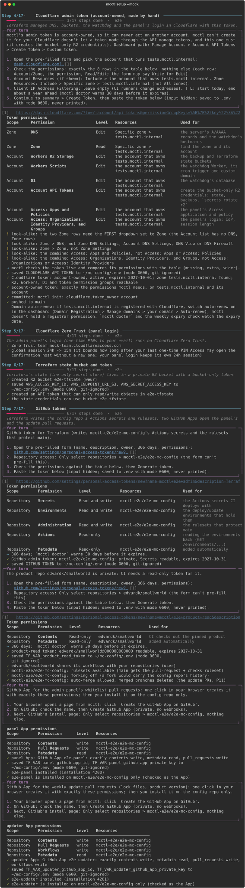

# Setting up a server

This guide takes you from nothing to a running, backed-up, monitored Minecraft server. It follows `mcctl setup`
step by step, in the order it asks, and ends with every error we hit during the first live setup and how to fix
it. You don't need to know Terraform or Ansible: mcctl drives them.

**Time:** about two hours of your attention for a first run, most of it creating accounts and tokens. You can
stop at any point (Ctrl-C, or press Enter at the server prompt) and run the same command again later; finished
steps are skipped and every run ends with a checklist.

**Money:** mcctl never orders or pays for anything. You buy the server (dedicated cores and 8 GB recommended) and a
domain yourself. Everything else runs on free plans, with GitHub Pro optional ([README](../README.md#what-it-costs)).

Contents:
[1. Prepare your computer](#1-prepare-your-computer) ·
[2. Create the accounts](#2-create-the-accounts) ·
[3. Run setup](#3-run-setup) ·
[4. The steps one by one](#4-the-steps-one-by-one) ·
[5. What bootstrap changes on the server](#5-what-bootstrap-changes-on-the-server) ·
[6. After setup](#6-after-setup) ·
[7. Troubleshooting](#7-troubleshooting)

## 1. Prepare your computer

mcctl runs on your computer (the "controller"); the server only receives what it deploys. You need:

| Tool | Version | Why |
|---|---|---|
| Python | >= 3.12 (with `venv`) | mcctl itself, and the pinned Ansible it installs |
| git | any recent | the config repo |
| GitHub CLI `gh` | any recent, logged in | creating the config repo, pushes, watching CI |
| Terraform | **exactly 1.17.1** | the cloud resources (the product pins this version) |
| Tailscale | any recent, connected | after bootstrap, the only way to SSH into the server |
| OpenSSH client + a key | `~/.ssh/id_ed25519.pub` (or ecdsa/rsa) | the first login to the new server as root |

Create an SSH key if you don't have one: `ssh-keygen -t ed25519` (Enter for the defaults; a passphrase is fine).

Step 1 of setup checks all of these and prints the install command for your system if something is missing.

### macOS

```bash
xcode-select --install                     # git
brew install python gh hashicorp/tap/terraform
gh auth login && gh auth setup-git
```

Install the Tailscale app from <https://tailscale.com/download/mac> and log in. Check `terraform version` says
1.17.1; if Homebrew installed a newer one, use the zip from <https://releases.hashicorp.com/terraform/1.17.1/>.

### Debian / Ubuntu

```bash
sudo apt install git python3-venv openssh-client
# GitHub CLI: GitHub's apt repository, https://github.com/cli/cli/blob/trunk/docs/install_linux.md
gh auth login && gh auth setup-git
curl -fsSL https://tailscale.com/install.sh | sh && sudo tailscale up
```

Terraform: HashiCorp's apt repository (<https://developer.hashicorp.com/terraform/install>) pinned to 1.17.1, or
the zip as in the WSL section below. Fedora: the same with `dnf` (`gh` and `python3` are in Fedora's own
repositories).

### Windows: use WSL2

mcctl runs inside WSL2 (it needs a Unix shell, SSH and Ansible). This is the setup the first live run used:

1. In PowerShell (as administrator): `wsl --install -d Ubuntu-26.04`, reboot if asked, open "Ubuntu" and create
   your Linux user. Ubuntu 26.04 ships Python 3.14, which is fine.
2. **Keep everything inside the Linux file system**, for example `~/code/smallworld` (the product) and
   `~/code/mc-config` (your config repo). Not under `/mnt/c/...`: it is slow there, and Windows file permissions
   break the `.env` check (mcctl insists on mode 0600 for the file that holds your tokens).
3. Tools:

   ```bash
   sudo apt update && sudo apt install -y git python3-venv unzip openssh-client
   # GitHub CLI: GitHub's apt repository (https://github.com/cli/cli/blob/trunk/docs/install_linux.md)
   gh auth login            # GitHub.com, HTTPS, log in with a web browser
   gh auth setup-git        # lets git push over HTTPS with gh's login (setup pushes to your config repo)
   ```

4. Terraform from the official zip (HashiCorp's apt repository may not have a package for the newest Ubuntu yet):

   ```bash
   cd /tmp
   curl -fsSLO https://releases.hashicorp.com/terraform/1.17.1/terraform_1.17.1_linux_amd64.zip
   curl -fsSLO https://releases.hashicorp.com/terraform/1.17.1/terraform_1.17.1_SHA256SUMS
   grep linux_amd64.zip terraform_1.17.1_SHA256SUMS | sha256sum -c -
   mkdir -p ~/.local/bin && unzip -o terraform_1.17.1_linux_amd64.zip -d ~/.local/bin
   terraform version        # Terraform v1.17.1 (open a new shell if ~/.local/bin isn't on PATH yet)
   ```

   (On an ARM machine use `linux_arm64` in both names.)
5. **Tailscale inside WSL**, not only on Windows: mcctl's SSH runs inside Linux, so the Linux side needs its own
   tailnet node. `curl -fsSL https://tailscale.com/install.sh | sh && sudo tailscale up` and open the login link
   it prints. This needs systemd in WSL, which current Ubuntu images enable by default (`/etc/wsl.conf`:
   `[boot]` `systemd=true`). The Windows Tailscale app can stay installed; the two are separate devices.
6. `ssh-keygen -t ed25519` inside WSL (your Windows key in `C:\Users\...` is not used).
7. Browsers: setup opens links in your Windows browser (`wslview`, else `explorer.exe`) and copies your SSH key
   to the Windows clipboard. The GitHub App step uses a page on `127.0.0.1` that the Windows browser reaches
   through WSL2's localhost forwarding (confirmed in the first live run). If a link doesn't open, copy the URL
   printed on its own line.

### The product checkout

```bash
mkdir -p ~/code && cd ~/code
gh repo clone edvardk/smallworld && cd smallworld
python3 -m venv .venv && . .venv/bin/activate
pip install --require-hashes --no-deps -r requirements/deploy.txt
pip install --no-deps -e .           # the `mcctl` command in this venv (else: python3 -m mcctl)
ansible-galaxy collection install -r ansible/requirements.yml
mcctl --version
```

`pip install --no-deps -e .` adds the `mcctl` command to the venv: an editable install, so the command always
runs this checkout (and mcctl's re-execution of the pinned product works as before); pip fetches the build
backend `pyproject.toml` pins (setuptools). Without it, `python3 -m mcctl ...` is the same command. Inside the
active venv `python` works too, but many systems have no `python` outside one: the docs write `mcctl`.

Run mcctl from a **clean** checkout of a commit that is pushed to GitHub: your config repo will pin that commit,
and its CI fetches the product by that SHA. Later, after `git pull` in the product, `mcctl setup` and `mcctl
doctor --fix` offer to move your config repo's pin forward to it ([below](#a-fix-you-pulled-doesnt-take-effect)).

## 2. Create the accounts

Do these once, before or during setup (setup tells you when it needs each):

| Account | Plan | Notes |
|---|---|---|
| **Cloudflare** | Free | Use a **dedicated Cloudflare account** (its own login) for this server: add your domain to it and point the registrar's nameservers at Cloudflare. Everything setup creates (tokens, buckets, the Worker, Zero Trust) then lives in an account that can't touch anything else you own |
| **Cloudflare Zero Trust** | Free (up to 50 users) | Only for the admin panel. At <https://one.dash.cloudflare.com/> in that account: choose a team name and the Free plan. Cloudflare may ask for a payment method even for Free. Setup detects a missing organization and waits |
| **GitHub** | Free, or Pro for rulesets | Your config repo is private; protecting its `main` branch with rulesets needs GitHub Pro on a personal account. Without it, setup tells you to set `github.protect_main: false` |
| **Tailscale** | Personal (free) | Log in with GitHub (your login is then `you@github`) or another identity; setup asks for it as `admin.tailscale_login` |
| **Discord** | free | Optional: alerts (a channel webhook) and slash commands (an application) |
| **A server provider** (e.g. netcup) | a root server or VPS | Ordered during setup, step 13 ([below](#step-13-the-server-machine)) |
| **Dashlane** | optional | Only if you want the admin tokens there instead of in `.env` ([below](#dashlane-optional)) |

## 3. Run setup

```bash
cd ~/code/smallworld && . .venv/bin/activate
mcctl setup -C ~/code/mc-config
```

`-C` is the local folder for your config repo (created if missing). `--seed <file>` starts `server.yml` from an
existing one (e.g. kept from an earlier deployment); without it setup asks.

What to expect on screen: each step has a header (`[4/17] ...`, numbered 1 to 17 like the checklist) saying why it exists, a "Your turn" box with
numbered actions and clickable links (the full URL is printed on its own line to copy), tables for the exact
permissions to tick, spinners while mcctl waits, and on a failure a box with the cause, the fix and the command
to run next. Terraform's own output goes to `~/code/mc-config/.mcctl/logs/` (mode 0600); only its errors are
shown. `--plain` (or `NO_COLOR`) prints the same conversation as plain lines.



Rules that hold for every step:

- **Credentials** are typed into hidden prompts, checked live against the provider's API, and written only to
  `~/code/mc-config/.env` (mode 0600, git-ignored), as values or as Dashlane references. They never appear in
  output, on a command line, in git or in `.mcctl/state.json`.
- **Anything that changes your cloud accounts** (each `terraform apply`, bootstrap) shows a plan first and waits
  for you to type the deployment name. There is no `--yes`.
- **Re-running is safe.** Finished steps are skipped (a step re-runs if its inputs changed); `--from STEP`
  re-runs from a step (number or name, e.g. `--from cloudflare`). A resumed setup never asks again what you
  already answered (e.g. Discord slash commands yes/no, kept as `discord.commands` in `server.yml`);
  `--reconfigure STEP` re-runs just that step and asks again (e.g. `mcctl setup --reconfigure discord`).

## 4. The steps one by one

### Step 1: Prerequisites

Checks the tools above and that `python -m venv` works (Debian/Ubuntu split it into `python3-venv`).

### Step 2: Config repo

Asks for the GitHub repository name (default `<your login>/mc-config`), creates it **private** if it doesn't
exist (it holds your deployment's settings; a private product repo would also share its reusable workflow only
with private repositories of its owner's account), writes the template pinned to the product commit you are
running, commits and pushes.

### Step 3: Your server (server.yml)

A few questions, each checked against the schema (Enter takes the default): deployment name, domain and hostname
(players join `mc.<your domain>`), time zone, **the Minecraft version** (your explicit choice; it must be at
least your world's version), accepting the [Minecraft EULA](https://aka.ms/MinecraftEULA), world border, your
name, Tailscale login and the email allowed into the panel (Cloudflare Access mails one-time codes there; it
need not be your Cloudflare login), Discord on/off, the operator and the first players (UUIDs looked up at
Mojang). Writes and pushes `server.yml` and `players.yml`.

### Step 4: Cloudflare admin token

The one credential you must click together by hand. Cloudflare refuses to create a token that may manage other
tokens through its API (error 1001), and this token must (it creates the small bucket-only R2 tokens for the
Terraform state and the backups), so mcctl can't mint it for you. Setup prints a pre-filled link; check every
row anyway.

In the Cloudflare dashboard, **in the account that owns your domain**: **Manage Account > Account API Tokens >
Create Token > Custom token (Get started)**. It must be an *account* token (Manage Account), not a user token
(My Profile): an account-owned token can never act on another Cloudflare account you belong to. Token name:
anything, e.g. `mcctl <name> (admin)`.

**Permissions: exactly these 8 rows, nothing else.** Each row has three dropdowns: Account/Zone, the permission,
Read/Edit (the form may say Write where this says Edit):

| Row | What it is for |
|---|---|
| Zone > DNS > Edit | the server's A/AAAA records and the watchdog's hostnames |
| Zone > Zone > Read | find the zone and its account |
| Account > Workers R2 Storage > Edit | the backup and Terraform state buckets |
| Account > Workers Scripts > Edit | the watchdog Worker, its cron trigger and custom domain |
| Account > D1 > Edit | the watchdog's database |
| Account > Account API Tokens > Edit | create the bucket-only R2 credentials (state, backups, `mcctl secrets rotate r2`) |
| Account > Access: Apps and Policies > Edit | the panel's Access application (`panel.mode: cloudflare`, the default) |
| Account > Access: Organizations, Identity Providers, and Groups > Edit | the panel's login: identity provider, session length |

**Look-alikes the form also offers. Don't pick these** (this was the first live run's mistake):

| Instead of | Pick |
|---|---|
| Zone DNS Settings, Account DNS Settings, DNS View, DNS Firewall | Zone > **DNS** (the two Zone rows need the **first** dropdown set to Zone; the Account list has no DNS or Zone rows) |
| Zone Settings | Zone > **Zone** |
| Access: Apps, Access: Policies | the combined **Access: Apps and Policies** |
| Access: Organizations, Access: Identity Providers, Access: Groups | the combined **Access: Organizations, Identity Providers, and Groups** |

Then:

- **Account Resources** (if shown): Include > that account.
- **Zone Resources:** Include > **Specific zone** > your domain (not All zones).
- **Client IP Address Filtering:** leave empty (GitHub's runners have changing addresses).
- **TTL: set the end date about a year ahead**, and check it on the summary page. The first live run ended up
  with a one-week token by accident; `mcctl doctor` shows the expiry and warns 30 days before it.
- Continue to summary > Create Token, copy it, paste it into setup's hidden prompt.

Setup verifies the token, then audits its own policies against the table: anything missing, extra or reaching
further is named, including which row a look-alike was meant to be. `mcctl doctor --cloudflare-permissions`
lists the exact names your account's form offers and audits the token against them (read-only).

If the domain is registered with Cloudflare, switch **auto-renew** on yourself (Domain Registration > Manage
domains); the token deliberately has no registrar permission. `mcctl doctor` and the weekly expiry check watch
the expiry date over RDAP.

### Step 5: Cloudflare Zero Trust (panel login)

Detects the account's Zero Trust organization (if missing: sign up as in [section 2](#2-create-the-accounts);
setup waits and re-checks). Then the **global session duration**: it bounds how long after your last one-time
code Cloudflare may open the panel's confirmation page (stop, restore, plugin switches) without asking again.
Up to 30 minutes is accepted as you set it. A longer one (a new organization starts at 24 h) is set to 15 minutes
through the API; if Cloudflare refuses, set it yourself: **Zero Trust > Access controls > Access settings > Set
your global session duration: 15 minutes**, and re-run. Your normal panel login keeps its own 24 h session.

### Step 6: Terraform state bucket

Creates the R2 bucket for Terraform's state and a token that can only read and write objects in that bucket,
checks it, and saves it to `.env`. Nothing for you to do.

### Step 7: GitHub tokens and Apps

1. **Admin token** for Terraform: a fine-grained personal access token from a pre-filled link (GitHub has no API
   to create one). Repository access: **Only select repositories > your config repo**. Permissions: **Secrets**
   read/write and **Administration** read/write (the rulesets). 366 days.
2. **Product read token**, optional, only if the product repo is private (a private copy or fork): Only select
   repositories > the product repo, **Contents** read. CI uses it to check out the pinned product.
3. Setup checks the product's Actions access setting (for a private product: your private repos may call its
   workflow) and whether your config repo can have rulesets (GitHub Pro on a personal account).
4. **Two GitHub Apps**, each created through GitHub's App manifest flow: setup opens a local page on
   `127.0.0.1`, which posts the App's definition to GitHub; you click **Create GitHub App**, GitHub redirects
   back with a code, and setup turns it into the App's id and private key (saved to `.env`). Then **Install** it
   on **Only select repositories > your config repo**. The **panel App** (Contents + Pull requests write) opens
   the whitelist pull requests from the admin panel; its key ends up only in the Cloudflare Worker. The
   **updater App** (also Workflows write) opens the weekly update pull requests; its key is read only by the
   scheduled update job. Setup checks each installation as the App (it signs a short JWT with `openssl`). If
   GitHub's redirect doesn't come back within a minute, setup asks for the URL in your browser's address bar or
   the installation id (GitHub > Settings > Applications > the App > Configure: `.../installations/<id>`).

### Step 8: Product repo settings (owner only)

Only if you administer the product repo: auto-merge, delete merged branches, Actions access for your private
repos, Dependabot, and a ruleset on `main` requiring CI. Others skip this step. `mcctl product-setup --check`
shows the difference later.

### Step 9: Discord (optional)

- **Alerts:** in Discord, channel settings > Integrations > Webhooks > New Webhook > Copy Webhook URL; paste it.
  Setup checks it without posting.
- **Slash commands:** Discord has no API to create an application, so:
  1. <https://discord.com/developers/applications> > **New Application** (e.g. `my server`), accept the terms.
  2. **Bot > Reset Token**, copy it, paste it into setup's hidden prompt. It stays on your computer (`.env` or
     Dashlane); the server and the Worker never get it. No privileged intents are needed. Setup reads the
     application id and public key itself.
  3. In Discord: User Settings > Advanced > **Developer Mode** on. Right-click your server's icon > **Copy Server
     ID**; the channel for the commands > **Copy Channel ID**; your own name > **Copy User ID**. Only these may
     use the commands.
  4. Open the install link setup prints (commands only, no bot user, your server pre-selected) and authorise.
     Setup registers the commands; after the apply (step 12) it points the application's interactions endpoint
     at the Worker.
- Your yes/no to slash commands is kept (`discord.commands` in `server.yml`): a resumed setup doesn't ask again.
  To change it later: `mcctl setup --reconfigure discord`.

### Step 10: Tailscale

A chicken-and-egg: Terraform's Tailscale credential (an OAuth client) may only own tags that already exist in
the tailnet policy, and the policy is what Terraform writes. So you create one short-lived **API access token**:
admin console > **Settings > Keys > Generate API access token** (1 day expiry is enough), paste it. Setup applies
the policy with it (typed confirmation), creates the OAuth client through the API (tag `tag:mc-terraform`,
exactly the scopes Terraform needs), saves the client to `.env`, revokes the API token and checks the revocation.

### Step 11: Cloud resources (terraform apply)

The plan as a table (DNS, the backup bucket with its lock, the Worker with its database and custom domains, the
panel's Access applications, the tailnet server key and CI identity, generated passwords, your config repo's
Actions secrets and rulesets), then type the deployment name. Afterwards setup stores the **restic password**
(the key to your backups) with 1Password (`op`) or Bitwarden (`bw`) if one is signed in, or shows it once for a
Dashlane Secure Note; otherwise run `mcctl secrets show-restic -C ~/code/mc-config` and put it in your password
manager. Without it the backups can't be read.

### Step 12: Discord commands endpoint

Sets the application's Interactions Endpoint URL to `https://hb.<host>/discord/interactions`; Discord accepts it
only after the Worker answered its signed PING.

### Step 13: The server machine

Setup pauses here until you have a server. Press Enter at the IPv4 prompt to stop and resume later.

**Dedicated cores or a VPS?** A root server (dedicated server, "RS" at some providers) has dedicated CPU cores; a
VPS shares its vCores with other customers and costs less. Minecraft runs its world on one thread and is sensitive
to stolen CPU time, so dedicated cores are the recommendation; a VPS works for a small group (`mc-health` reports
CPU steal and suggests a move if it hurts). Any provider works: a public IPv4 (IPv6 recommended), Debian 13/12 or
Ubuntu 24.04, amd64 or arm64, at least 4 GB RAM (8 GB recommended; on 2-4 GB set `performance.vm: small`,
[operations](operations.md#small-vm-preset-v15); its heap figures are computed, not yet measured on a real 4 GB VM:
measure first).

The steps below use netcup as the example provider (its control panel is the SCP, Server Control Panel); other
providers have the same steps under other names.

1. Order the server, with **IPv4 and IPv6**. A location near your players.
2. In the SCP (Server Control Panel), install the **Debian 13** image (Media > Images) and **add your SSH public
   key** in the installation dialog. Setup shows the key (and copies it to the clipboard where it can).
3. **Root login with a password over SSH is disabled** on the image, so the key must be on the server: if you
   missed it in the installation, either reinstall the image with the key, or open the SCP's VNC console, log in
   as root with the password from netcup's email, and append the key to `/root/.ssh/authorized_keys`. (Setup
   offers `ssh-copy-id`, which only works on images that still allow password logins.)
4. **SCP firewall:** leave it off; the host's own firewall is the source of truth.
5. Give setup the **IPv4** from the SCP. It shows the server's host key fingerprint (compare it with the SCP's
   console or first-boot log and confirm), logs in as root, checks OS, architecture and RAM, and **detects the
   IPv6 address** configured on the host. Only if the host has none does it ask: paste one full address (e.g.
   `3ffe:ffff:6:1234::1`, without `/64`) after configuring it on the host, or `none` for IPv4 only.
6. **Passphrase on your SSH key?** mcctl's SSH runs non-interactively, so the key must be in ssh-agent: run
   `eval "$(ssh-agent -s)" && ssh-add ~/.ssh/id_ed25519` in the terminal you run setup from (setup says so when
   that's why the login is refused).

### Step 14: Bootstrap

One apply mints a fresh single-use Tailscale key for the server (typed confirmation), then `bootstrap.yml` runs
as root over public SSH: it joins the server to your tailnet, creates the `deploy` user, enables Tailscale SSH and
the firewall, and **closes public SSH**. Setup verifies that `ssh deploy@<server name>` works over the tailnet
and that port 22 no longer answers on IPv4 and IPv6 before it moves on. [What changes](#5-what-bootstrap-changes-on-the-server).

### Step 15: First deploy

Sets `deploy.enabled: true`, pushes, and watches the GitHub Actions run: Java, Purpur, the plugins, the configs,
backups, monitoring and the agent.

### Step 16: Smoke test

A Minecraft status ping over IPv4 and over IPv6 from your computer, and the watchdog's `/status` is fresh.

### Step 17: First backup, restore check, doctor

A backup, a restore check into a scratch directory, then `world.expected: true` (from now on a deploy refuses
to start a new empty world if it can't restore the old one), and `mcctl doctor`, which writes `expiry.yml`
(credential expiry dates) and commits it. Setup ends with a summary of what exists.

### Dashlane (optional)

If the Dashlane CLI is installed and set up (`dcli sync` once: email, code, master password), setup offers it as
the place for the credentials it asks for. `dcli` can only read Dashlane, so for each credential setup shows the
item to create (a **Password** item titled `mcctl-<name>-<key>`, the secret in its password field), runs `dcli
sync`, reads it back and writes only the reference (`dl://mcctl-<name>-<key>/password`) to `.env` if it returns
the same value. The restic password is shown once for a **Secure Note** `mcctl-<name>-restic`. Later: `mcctl
secrets dashlane` lists the items for an existing `.env`, `--convert` swaps values for references, and `mcctl
doctor` checks that every reference resolves.

## 5. What bootstrap changes on the server

| Before bootstrap | After bootstrap |
|---|---|
| root logs in over public SSH with your key | **OpenSSH is masked**; public port 22 is closed (nftables drops everything except Minecraft 25565/tcp, Tailscale 41641/udp and ICMP) |
| no tailnet | the server is a Tailscale node named after `host.tailscale_name`, tagged `tag:mc-server` |
| only root | you log in as **`deploy`** through **Tailscale SSH** (`ssh deploy@<name>` or `mcctl ssh`), with passwordless `sudo`; CI logs in the same way from a short-lived tailnet node (`tag:ci`), never with a stored key |
| | root SSH is refused even over the tailnet (the tailnet policy allows only `deploy`) |

**Break-glass** (Tailscale broken, the server unreachable): root's password is locked after the first deploy, so
use the provider's rescue system (netcup SCP > Media > Rescue system, then the VNC console): mount the root
filesystem, `chroot` into it and `passwd root` (or unmask sshd there), reboot normally; then on the console:
`systemctl unmask ssh.socket ssh.service && systemctl start ssh.service`; for public SSH also
`nft add rule inet mc_filter input tcp dport 22 accept` (gone on the next deploy, which is the point). Fix
Tailscale, then deploy: SSH is masked again. Details in [SECURITY.md](../SECURITY.md#hardening-on-the-box-design-7-as-built-in-p7).

## 6. After setup

- Join `mc.<your domain>` in Minecraft. A brand-new world: [new-world.md](new-world.md) (the first start
  pre-generates the bordered worlds while nobody is online).
- Open the panel at `https://panel.<your domain>` (Cloudflare Access sends a one-time code to the admin email).
- Commit `expiry.yml` changes when `mcctl doctor` updates it.
- Day-to-day use: [operations.md](operations.md).

## 7. Troubleshooting

Every error below happened in the first live setup. Most are fixed in mcctl now (it explains or avoids them),
but you may still meet them with an older pin or a hand-made setting.

| You see | Why | Fix |
|---|---|---|
| Cloudflare `1001: sub-token is not allowed to have permissions to manage other tokens` | An API-made token may not manage tokens, so the admin token can't be minted | Create the account token by hand (step 4). If an older mcctl had you create a token named `mcctl <name> bootstrap`, delete it (Manage Account > Account API Tokens, or My Profile > API Tokens) |
| Cloudflare error `9109` while checking the token | The token is account-owned and the user-level permission listing doesn't apply to it | Nothing: mcctl re-checks it under the zone's account and reports "account-owned". On an old pin: move the pin forward (last row) |
| Setup's audit: "missing Access: Apps and Policies", "extra Access: Apps" (or DNS Settings, Zone Settings, ...) | A look-alike permission was picked in the token form | Edit the token (or create a new one) with the exact rows from step 4; `mcctl doctor --cloudflare-permissions` shows your account's exact names |
| `mcctl doctor`: Cloudflare token expires in a few days | The token form's TTL defaulted to a short window | Create a new token with an end date about a year ahead, put it in `.env` as `CLOUDFLARE_API_TOKEN` (or delete that line and re-run `mcctl setup`, which asks again), run `mcctl doctor`, then delete the old token |
| Zero Trust `400 12062 invalid_org_config` | Cloudflare refused the session-length update (below its 15-minute minimum, or a partial object) | Fixed in mcctl (it accepts up to 30 min as set and writes a cleaned object). If it still refuses: Zero Trust > Access controls > Access settings > global session 15 minutes, then re-run |
| `terraform apply`: Access identity provider `403` (code 1010) | The account already has a one-time PIN login method and Cloudflare allows one | Fixed: Terraform reuses the existing one. On an old pin: move the pin forward |
| `terraform apply`: `cloudflare_workers_script.watchdog` `412`, code `10079` "Actor migration tag precondition failed, got tag '' when expected tag is 'v1'" | The Worker already has its Durable Object migration (tag `v1`, from an earlier, partly failed apply), and the old configuration sent it again on every upload | Fixed: Terraform reads the Worker's live tag and sends the migration only while it is missing (a Worker without the tag, or none yet). Move the pin forward and re-run `mcctl setup`; no clean-up needed. The next apply after that shows one in-place update of the Worker (`migrations` to null): expected. A plan error naming an unknown tag means someone else migrated the Worker: check it in Workers & Pages |
| GitHub `422 ... Actor ... integration must be part of the ruleset source or owner organization` | On a repository of a personal account a GitHub App can't be a ruleset bypass actor | Fixed: no App bypass; `server / gate` binds update and panel pull requests to each App's bot user. On an old pin: move the pin forward |
| Setup or doctor: the config repo can't have rulesets | Rulesets on a private repo of a personal account need a paid plan | Upgrade, or set `github.protect_main: false` in `server.yml` (read SECURITY.md's "Not covered") |
| Tailscale `400 ... requested tags [...] are invalid or not permitted` | A credential may create keys only with tags it owns; an OAuth client with both server and CI tags can create neither | Fixed: the client carries only `tag:mc-terraform`, which the policy makes owner of both. Setup replaces a client made with the old tags (it asks for a one-off API token) |
| `gio: Operation not supported` in WSL, or no browser opens | The Linux opener doesn't reach the Windows browser | Fixed (mcctl uses `wslview`/`explorer.exe`). Otherwise copy the printed URL into your browser |
| Setup waits forever after you installed a GitHub App | GitHub's redirect after the install went to a page that had closed | Fixed (one local page serves both clicks, and setup polls GitHub's API). If nothing happens within a minute, paste the address-bar URL or the installation id when asked |
| `GitHub App <name>-panel isn't visible (HTTP 404)` on a re-run | The Apps are private, and GitHub answers 404 to anyone but the App itself | Fixed: mcctl checks the App as the App (JWT from the key in `.env`). If GitHub rejects the key: delete the App (Settings > Developer settings > GitHub Apps), remove its two lines from `.env`, re-run |
| <a name="a-fix-you-pulled-doesnt-take-effect"></a>A fix you pulled into the product doesn't take effect; setup repeats an old error | The config repo pins an older product commit, and setup re-runs itself in that pinned commit | `git pull` in the product checkout, re-run `mcctl setup`: it lists the commits in between and, after you type `yes`, moves the pin forward (commit + push), then continues in the new code. `mcctl doctor` reports a stale pin; `mcctl doctor --fix` makes the same offer. Only forward along the product's history, only to a commit on the product repository's `main`, and only when the config repo's `main` is up to date (`git pull --rebase` there first) |
| First deploy: `tailscale/github-action` fails with `403` on the token exchange; the Tailscale console shows "Cannot validate subject" for the CI federated identity | GitHub's OIDC tokens for repositories created (or renamed/transferred) since 2026-07-15 carry the immutable `sub` `repo:OWNER@OWNER_ID/REPO@REPO_ID:ref:refs/heads/main`; older pins trusted only `repo:OWNER/REPO:ref:refs/heads/main` | Fixed: Terraform builds the subject from `server.yml` `github.oidc_subject` (`immutable`/`legacy`, set by setup from the GitHub API) and the numeric ids it reads from GitHub. Move the pin forward and re-run `mcctl setup`: it plans and applies the identity's new subject (type the name), then retries the deploy. `mcctl doctor` (`ci oidc subject`) shows the exact subject GitHub issues. A custom OIDC subject template on the repo can't match: reset it (`gh api -X PUT repos/OWNER/REPO/actions/oidc/customization/sub -F use_default=true`) |
| `ssh root@<ip>: Permission denied (publickey)` at step 13 | The image was installed without your key, and root password logins are disabled | Reinstall the image with your key, or add it through the VNC console (step 13) |
| Bootstrap (or deploy) fails: `couldn't resolve module/action 'ansible.posix.authorized_key'` | The pinned galaxy collections (`ansible/requirements.yml`) weren't installed: older mcctl installed them only when it fetched a pinned commit into its cache, not when your checkout is the pin | Fixed: mcctl installs the exact pinned versions into `~/.cache/mcctl/collections/` before every playbook and points Ansible only at them; setup's prerequisites and `mcctl doctor` check them (`mcctl doctor --fix` installs). On an old pin, by hand in the product checkout: `ansible-galaxy collection install -r ansible/requirements.yml`, then re-run |
| Bootstrap stops: "The node reports no 100.x tailnet address" although the server joined | The play's address regex kept a literal backslash and matched nothing | Fixed: move the pin forward and re-run `mcctl bootstrap` (public SSH stays open until that check passes). A server already on the tailnet keeps its node: no new key is minted |
| Bootstrap stops: the node isn't named `<name>` | An old machine still holds the tailnet name | Delete the old machine in the Tailscale admin console, re-run |
| `.env` "mode 0644" / doctor fails on `.env` | The file is readable by others (often: under `/mnt/c` in WSL) | `chmod 600 .env` (or `mcctl doctor --fix`); keep the config repo in the Linux file system |

Still stuck: `mcctl doctor -C ~/code/mc-config` checks every tool, token and setting and says what to do; the
Terraform log of the failed run is under `.mcctl/logs/`; `mcctl setup --from <step>` re-runs one step.
